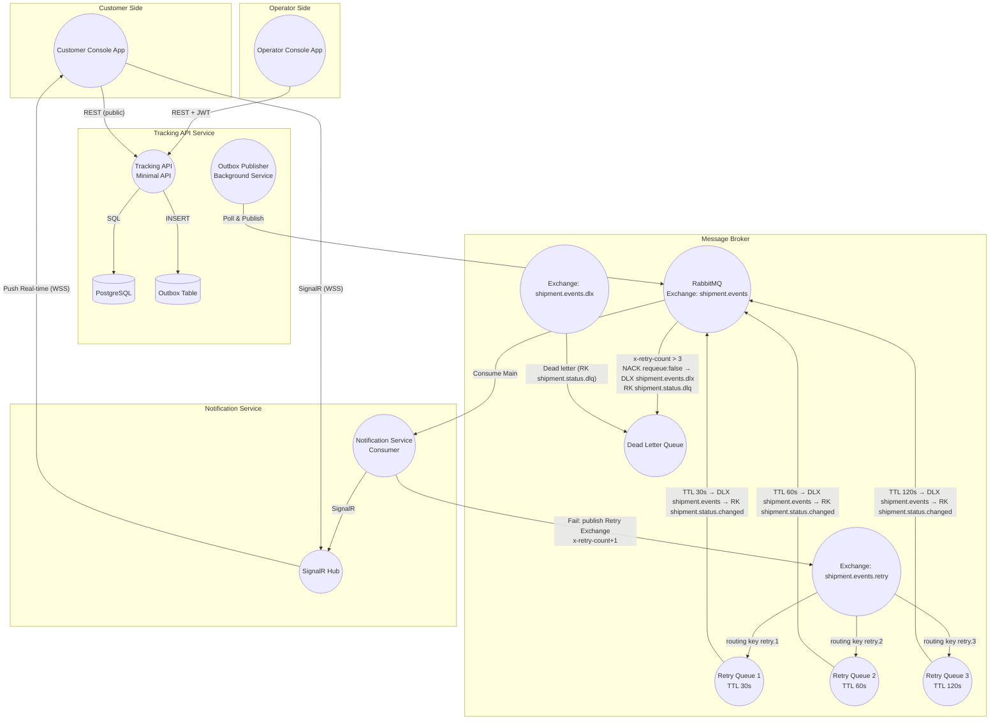

# Thiết kế kiến trúc chi tiết - Hệ thống theo dõi bưu gửi

## 1. Kiến trúc tổng thể

### 1.1 Sơ đồ kiến trúc (Mermaid)



### 1.2 Danh sách thành phần và phân loại

| Thành phần | Loại | Mô tả |
|------------|------|-------|
| **Operator Console App** | .NET Console App (độc lập) | UI cho nhân viên vận hành, gọi Tracking API với JWT |
| **Customer Console App** | .NET Console App (độc lập) | UI cho khách hàng, kết nối SignalR (WSS), gọi API công khai |
| **Tracking API** | .NET Minimal API Service (độc lập) | Core service: CRUD shipment/event, validation, Outbox write, JWT auth. Sở hữu `TrackingDbContext` (5 bảng: shipments, shipment_events, operators, customer_subscriptions, outbox_messages) |
| **PostgreSQL** | Infrastructure | Primary database dùng chung: shipments, events, outbox, operators, subscriptions (Tracking) + processed_events, shipment_processing_state (Notification) |
| **Outbox Publisher** | Background Service (bên trong Tracking API) | Poll outbox table mỗi 1 giây, claim lease, publish to RabbitMQ với exponential backoff, mark processed |
| **RabbitMQ** | Infrastructure | Message broker: exchange `shipment.events`, main queue, retry queue, DLQ |
| **Notification Service** | .NET Background Service (độc lập) | Consume RabbitMQ, verify subscription qua internal API, idempotent processing, forward to SignalR Hub. Sở hữu `NotificationDbContext` (2 bảng: processed_events, shipment_processing_state) |
| **SignalR Hub** | Component (bên trong Notification Service) | Manage customer connections (WSS), push real-time notifications |

> **Lưu ý**: Outbox Publisher chạy trong process của Tracking API (IHostedService). SignalR Hub chạy trong process của Notification Service. Mỗi service .NET độc lập có Dockerfile riêng.
>
> **Mô hình Database Ownership (Phương án A — 2 DbContext, 1 database)**: Hai service .NET độc lập kết nối **cùng một PostgreSQL database** nhưng mỗi service sở hữu một `DbContext` riêng, **không chia sẻ bảng**:
> - **Tracking.Api → `TrackingDbContext`** quản lý 5 bảng: `shipments`, `shipment_events`, `operators`, `customer_subscriptions`, `outbox_messages`.
> - **Notification.Service → `NotificationDbContext`** quản lý 2 bảng: `processed_events`, `shipment_processing_state`.
> - **Không có Internal Data API.** Notification Service **có** DbContext riêng (đọc/ghi `processed_events`, `shipment_processing_state`) — phù hợp pseudocode Section 6.4. Internal API `POST /internal/subscriptions/verify` **vẫn giữ nguyên** (chỉ verify subscription qua HTTP, không phải để truy cập DB thay cho DbContext).
> - Mỗi service **tự quản lý migration** của các bảng thuộc quyền sở hữu. Chi tiết connection strings và quy trình migration ở Section 8.4 và Section 8.7.

---

## 2. Thiết kế cơ sở dữ liệu (PostgreSQL)

### 2.1 Bảng `shipments`

| Cột | Kiểu | Ràng buộc | Mô tả |
|-----|------|-----------|-------|
| `id` | `UUID` | PK, `gen_random_uuid()` | Khóa chính nội bộ |
| `tracking_code` | `VARCHAR(32)` | UNIQUE, NOT NULL | Mã theo dõi: `PKG-YYYYMMDD-XXXXXXXX` |
| `sender_name` | `VARCHAR(200)` | NOT NULL | Tên người gửi |
| `sender_phone` | `VARCHAR(20)` | NOT NULL | SĐT người gửi |
| `sender_address` | `VARCHAR(500)` | NOT NULL | Địa chỉ người gửi |
| `receiver_name` | `VARCHAR(200)` | NOT NULL | Tên người nhận |
| `receiver_phone` | `VARCHAR(20)` | NOT NULL | SĐT người nhận |
| `receiver_address` | `VARCHAR(500)` | NOT NULL | Địa chỉ người nhận |
| `description` | `TEXT` | NULLABLE | Mô tả thêm |
| `current_status` | `VARCHAR(20)` | NOT NULL, DEFAULT 'Created' | Trạng thái hiện tại |
| `current_location` | `VARCHAR(200)` | NOT NULL | Vị trí hiện tại |
| `created_at` | `TIMESTAMPTZ` | NOT NULL, DEFAULT `now()` | Thời điểm tạo |
| `updated_at` | `TIMESTAMPTZ` | NOT NULL, DEFAULT `now()` | Thời điểm cập nhật cuối |
| `version` | `BIGINT` | NOT NULL, DEFAULT 0 | Optimistic concurrency |

**Index**: `IX_shipments_tracking_code` (unique), `IX_shipments_status` (current_status)

### 2.2 Bảng `shipment_events`

| Cột | Kiểu | Ràng buộc | Mô tả |
|-----|------|-----------|-------|
| `id` | `UUID` | PK, `gen_random_uuid()` | Khóa chính sự kiện |
| `shipment_id` | `UUID` | FK → `shipments.id`, NOT NULL | Tham chiếu shipment |
| `tracking_code` | `VARCHAR(32)` | NOT NULL | Denormalized cho query nhanh |
| `event_type` | `VARCHAR(50)` | NOT NULL | Loại: `StatusChanged`, `LocationUpdated` |
| `status` | `VARCHAR(20)` | NOT NULL | Trạng thái tại thời điểm này |
| `location` | `VARCHAR(200)` | NOT NULL | Vị trí tại thời điểm này |
| `description` | `TEXT` | NULLABLE | Mô tả sự kiện |
| `operator_id` | `UUID` | FK → `operators.id`, NOT NULL | ID nhân viên cập nhật |
| `timestamp` | `TIMESTAMPTZ` | NOT NULL, DEFAULT `now()` | Thời điểm xảy ra |
| `sequence` | `BIGINT` | NOT NULL | Số thứ tự trong shipment (1,2,3...) |

**Index**: 
- `IX_shipment_events_shipment_id_sequence` (shipment_id, sequence) — UNIQUE
- `IX_shipment_events_shipment_id_timestamp` (shipment_id, timestamp ASC)
- `IX_shipment_events_tracking_code` (tracking_code)
- `IX_shipment_events_operator_id` (operator_id)

**Quan hệ**: `shipments` 1──N `shipment_events` (cascade delete), `operators` 1──N `shipment_events`

### 2.3 Bảng `outbox_messages` (Transactional Outbox)

| Cột | Kiểu | Ràng buộc | Mô tả |
|-----|------|-----------|-------|
| `id` | `UUID` | PK, `gen_random_uuid()` | Khóa chính (cùng giá trị EventId) |
| `event_type` | `VARCHAR(100)` | NOT NULL | Loại event: `ShipmentStatusChanged` |
| `payload` | `JSONB` | NOT NULL | Toàn bộ nội dung event |
| `created_at` | `TIMESTAMPTZ` | NOT NULL, DEFAULT `now()` | Thời điểm ghi vào outbox |
| `processed_at` | `TIMESTAMPTZ` | NULLABLE | Thời điểm đã publish thành công |
| `next_attempt_at` | `TIMESTAMPTZ` | NOT NULL, DEFAULT `now()` | Thời điểm được phép retry tiếp theo |
| `retry_count` | `INT` | NOT NULL, DEFAULT 0 | Số lần thử publish |
| `last_error` | `TEXT` | NULLABLE | Lỗi lần thử cuối |
| `correlation_id` | `VARCHAR(100)` | NOT NULL | Correlation ID để trace (tạo 1 lần tại writer) |
| `locked_by` | `VARCHAR(100)` | NULLABLE | Instance ID đang xử lý (claim/lease) |
| `locked_until` | `TIMESTAMPTZ` | NULLABLE | Hết hạn lease |

**Index**: 
- `IX_outbox_messages_unprocessed` (processed_at IS NULL, next_attempt_at ASC) — cho publisher poll hiệu quả
- `IX_outbox_messages_correlation` (correlation_id)
- `IX_outbox_messages_lease` (locked_until) — để dọn lease hết hạn

**Trạng thái**: 
- `processed_at IS NULL` AND `next_attempt_at <= now()` AND (`locked_until IS NULL` OR `locked_until < now()`) AND `retry_count < 5` = sẵn sàng xử lý
- `processed_at` có giá trị = đã publish thành công
- `retry_count >= 5` AND `processed_at IS NULL` = lỗi kéo dài (cần can thiệp thủ công)

### 2.4 Bảng `operators` (cho JWT Authentication)

> **Sở hữu**: `TrackingDbContext` (Tracking.Api quản lý và migrate).

| Cột | Kiểu | Ràng buộc | Mô tả |
|-----|------|-----------|-------|
| `id` | `UUID` | PK, `gen_random_uuid()` | Khóa chính. **Database sinh** (default `gen_random_uuid()`), thống nhất với các bảng còn lại; không do ứng dụng tự sinh |
| `username` | `VARCHAR(100)` | UNIQUE, NOT NULL | Tên đăng nhập |
| `password_hash` | `VARCHAR(255)` | NOT NULL | BCrypt hash |
| `full_name` | `VARCHAR(200)` | NOT NULL | Tên hiển thị |
| `role` | `VARCHAR(50)` | NOT NULL, DEFAULT 'Operator' | Vai trò |
| `is_active` | `BOOLEAN` | NOT NULL, DEFAULT true | Trạng thái hoạt động |
| `created_at` | `TIMESTAMPTZ` | NOT NULL, DEFAULT `now()` | |

### 2.5 Bảng `customer_subscriptions` (quản lý quyền theo dõi)

> **Sở hữu**: `TrackingDbContext` (Tracking.Api quản lý và migrate).

| Cột | Kiểu | Ràng buộc | Mô tả |
|-----|------|-----------|-------|
| `id` | `UUID` | PK, `gen_random_uuid()` | Khóa chính |
| `shipment_id` | `UUID` | FK → `shipments.id`, NOT NULL, **ON DELETE CASCADE** | Tham chiếu shipment. Khi xóa shipment → xóa subscription kèm theo (đồng bộ với `shipment_events`) |
| `tracking_code` | `VARCHAR(32)` | NOT NULL | Mã bưu gửi (denormalized) |
| `token_hash` | `VARCHAR(255)` | NOT NULL | Hash của SubscriptionToken (BCrypt) |
| `created_at` | `TIMESTAMPTZ` | NOT NULL, DEFAULT `now()` | Thời điểm tạo subscription |
| `expires_at` | `TIMESTAMPTZ` | NULLABLE | Hết hạn (optional) |

**Index**: 
- `IX_customer_subscriptions_shipment_id` (shipment_id) — UNIQUE (1 shipment = 1 subscription)
- `IX_customer_subscriptions_tracking_code` (tracking_code)

> **Mục đích**: Lưu subscription lâu dài. Không lưu SignalR ConnectionId vì nó chỉ tồn tại trong phiên kết nối. Customer dùng TrackingCode + SubscriptionToken để xác thực khi join SignalR group. Token hash dùng BCrypt verify, không thể query trực tiếp bằng hash.

### 2.6 Bảng `processed_events` (Idempotent Consumer)

> **Sở hữu**: `NotificationDbContext` (Notification.Service quản lý và migrate).

| Cột | Kiểu | Ràng buộc | Mô tả |
|-----|------|-----------|-------|
| `consumer_name` | `VARCHAR(100)` | NOT NULL, PK (part 1) | Định danh consumer (ví dụ: `notification-service`) |
| `event_id` | `UUID` | NOT NULL, PK (part 2) | EventId từ message |
| `status` | `VARCHAR(20)` | NOT NULL, DEFAULT 'PENDING' | Trạng thái: `PENDING`, `PROCESSING`, `COMPLETED`, `FAILED` |
| `attempt_count` | `INT` | NOT NULL, DEFAULT 0 | Số lần thử xử lý (DB-level). Xem quy tắc reset bên dưới |
| `started_at` | `TIMESTAMPTZ` | NOT NULL, DEFAULT `now()` | Thời điểm bắt đầu xử lý |
| `completed_at` | `TIMESTAMPTZ` | NULLABLE | Thời điểm hoàn thành (thành công hoặc thất bại) |
| `error_message` | `TEXT` | NULLABLE | Lỗi nếu status = FAILED |
| `locked_by` | `VARCHAR(100)` | NULLABLE | Instance ID đang xử lý (claim) |
| `locked_until` | `TIMESTAMPTZ` | NULLABLE | Hết hạn lock processing |

**Primary Key**: `(consumer_name, event_id)` — composite

**Index**: 
- `IX_processed_events_status` (status) — để cleanup PENDING/PROCESSING cũ nếu cần
- `IX_processed_events_lease` (locked_until) — để phát hiện stuck processing

> **Mục đích**: Đảm bảo idempotency ở mức database với trạng thái xử lý rõ ràng và claim/lease tránh duplicate concurrent processing.
> - **PENDING**: Record đã tồn tại (inserted), chưa bắt đầu xử lý
> - **PROCESSING**: Claimed bởi một instance, đang xử lý (có `locked_by`, `locked_until`)
> - **COMPLETED**: Xử lý thành công (SignalR push đã gửi, `shipment_processing_state` đã cập nhật)
> - **FAILED**: Xử lý thất bại, có thể retry theo policy
> - **Quy trình**: INSERT PENDING → Atomic claim PROCESSING → COMPLETED/FAILED

> **Quy tắc reset `attempt_count` (DLQ Replay)**: `attempt_count` đếm số lần claim XỬ LÝ DB của event (DB-level), khác với `x-retry-count` (RabbitMQ header) và `x-publish-retry-count` (RabbitMQ header). Khi replay từ DLQ với header `x-dlq-replay=true`, consumer **reset `attempt_count = 0`** trong cùng transaction với claim PROCESSING (UPDATE ... SET status='PROCESSING', attempt_count = 0, locked_by=?, locked_until=...). Lý do: replay mở một chu kỳ xử lý mới với bug đã fix; nếu không reset, record FAILED với `attempt_count >= 4` sẽ bị guard `attempt_count < 4` chặn lần replay kế tiếp. Reset chỉ áp dụng khi `x-dlq-replay=true`; message đi qua retry queue thông thường (`x-retry-count` tăng, không có `x-dlq-replay`) **không** reset `attempt_count` — `attempt_count` tăng dần 1→4 song song với `x-retry-count` 1→3, đến khi vượt ngưỡng → FAILED + DLQ.
>
> **Phân biệt 3 counter**:
> - `processed_events.attempt_count` (DB, cột): số lần claim xử lý DB của event; reset về 0 khi DLQ replay. Dùng cho guard `attempt_count < 4` và stuck detection.
> - `x-retry-count` (RabbitMQ header): số lần message đã qua retry queue (0→3). Consumer dùng để chọn routing key `shipment.status.retry.{n}`. Reset về 0 khi DLQ replay.
> - `x-publish-retry-count` (RabbitMQ header): số lần publish retry message thất bại (0→3). Chỉ dùng khi publish sang retry exchange lỗi. Reset về 0 khi publish retry thành công hoặc khi DLQ replay.

### 2.7 Bảng `shipment_processing_state` (Ordering & Reconciliation)

| Cột | Kiểu | Ràng buộc | Mô tả |
|-----|------|-----------|-------|
### 2.7 Bảng `shipment_processing_state` (Ordering & Reconciliation)

> **Sở hữu**: `NotificationDbContext` (Notification.Service quản lý và migrate).

| Cột | Kiểu | Ràng buộc | Mô tả |
|-----|------|-----------|-------|
| `shipment_id` | `UUID` | PK, FK → `shipments.id`, **ON DELETE CASCADE** | Khóa chính, tham chiếu shipment. Khi xóa shipment → xóa state kèm theo |
| `tracking_code` | `VARCHAR(32)` | NOT NULL | Mã bưu gửi (denormalized) |
| `last_contiguous_sequence` | `BIGINT` | NOT NULL, DEFAULT 0 | Sequence lớn nhất **liên tiếp** đã xử lý thành công (1,2,3...N không gap) |
| `highest_seen_sequence` | `BIGINT` | NOT NULL, DEFAULT 0 | Sequence lớn nhất từng thấy (có thể có gap) |
| `processed_sequences` | `JSONB` | NOT NULL, DEFAULT `'[]'` | Danh sách sequence đã push SignalR thành công (ví dụ: `[2, 5, 7]`) |
| `updated_at` | `TIMESTAMPTZ` | NOT NULL, DEFAULT `now()` | Thời điểm cập nhật |

**Index**: `IX_shipment_processing_state_tracking_code` (tracking_code)

> **Mục đích**: Theo dõi sequence đã xử lý per shipment để phát hiện gap/stale event, lấp gap khi event còn thiếu đến sau, và hỗ trợ reconciliation.
>
> - `processed_sequences`: Lưu các sequence đã được push SignalR thành công (hoặc đã xác định là processed) VÀ nằm NGOÀI vùng liên tiếp đã xử lý. Khi `last_contiguous_sequence` tăng lên, các sequence <= `last_contiguous_sequence` được loại bỏ khỏi `processed_sequences` để tránh JSONB tăng vô hạn.
> - `last_contiguous_sequence`: Sequence lớn nhất N sao cho tất cả sequence 1..N đều đã được xử lý thành công.
> - `highest_seen_sequence`: Sequence lớn nhất từng nhận được (dùng để phát hiện gap lớn).
>
> **Khởi tạo record**: Record `shipment_processing_state` được khởi tạo bởi **Notification Service Consumer** khi xử lý event đầu tiên của shipment (INSERT ... ON CONFLICT DO NOTHING trong transaction). Record không được tạo khi tạo shipment ở Tracking API.
>
> **Quy trình cập nhật khi consumer xử lý event sequence = N thành công**:
> 1. Thêm N vào `processed_sequences` (nếu chưa có và N > last_contiguous_sequence).
> 2. Cập nhật `highest_seen_sequence = GREATEST(highest_seen_sequence, N)`.
> 3. Tính toán `last_contiguous_sequence` mới: bắt đầu từ `last_contiguous_sequence` cũ, tăng dần tối đa **trong khi** `(last_contiguous_sequence + 1)` có trong `processed_sequences`.
>    - Ví dụ: `last_contiguous_sequence=0`, `processed_sequences=[2]` → vẫn là 0 (vì 1 chưa có).
>    - Sau khi sequence 1 đến: `processed_sequences=[1,2]` → `last_contiguous_sequence` nâng lên 2, `processed_sequences` được làm trống thành `[]` (vì 1 và 2 đều nằm trong vùng liên tiếp).
> 4. Loại bỏ tất cả sequence <= `last_contiguous_sequence` khỏi `processed_sequences`.
> 5. Nếu `N <= last_contiguous_sequence` (cũ) → stale event → bỏ qua, không push, ACK.
> 6. Nếu `N > highest_seen_sequence + 1` → gap lớn → log warning, vẫn push, customer reconcile qua GET /history.
>
> **Khóa đồng thời**: Cập nhật bảng này trong cùng transaction với `processed_events` COMPLETED. Sử dụng `INSERT ... ON CONFLICT (shipment_id) DO NOTHING` để khởi tạo record nếu chưa tồn tại, sau đó `SELECT ... FOR UPDATE` trên dòng `shipment_processing_state` (theo `shipment_id`, là PK) để serialize tất cả consumer xử lý cùng một shipment. Lock được giữ cho đến khi `COMMIT`.

---

### 2.8 Tổng hợp Ownership & Thứ tự Migration (2 DbContext, 1 Database)

Hai service kết nối **cùng một PostgreSQL database** (`parcel_tracking`) nhưng mỗi service sở hữu một `DbContext` riêng, **không chia sẻ bảng**:

| # | Bảng | DbContext | Service | Migration Owner | FK phụ thuộc |
|---|------|-----------|---------|-----------------|--------------|
| 1 | `operators` | TrackingDbContext | Tracking.Api | Tracking.Api | — |
| 2 | `shipments` | TrackingDbContext | Tracking.Api | Tracking.Api | — |
| 3 | `customer_subscriptions` | TrackingDbContext | Tracking.Api | Tracking.Api | `shipments.id` ON DELETE CASCADE |
| 4 | `shipment_events` | TrackingDbContext | Tracking.Api | Tracking.Api | `shipments.id` CASCADE; `operators.id` |
| 5 | `outbox_messages` | TrackingDbContext | Tracking.Api | Tracking.Api | — (no FK) |
| 6 | `processed_events` | NotificationDbContext | Notification.Service | Notification.Service | — (no FK) |
| 7 | `shipment_processing_state` | NotificationDbContext | Notification.Service | Notification.Service | `shipments.id` ON DELETE CASCADE |

**Thứ tự migration**:
- **Tracking.Api** (5 bảng): `operators` → `shipments` → `customer_subscriptions` → `shipment_events` → `outbox_messages`. (FK `customer_subscriptions`/`shipment_events` phụ thuộc `shipments`; `shipment_events` phụ thuộc `operators` — phải tạo sau `operators`.)
- **Notification.Service** (2 bảng): `processed_events` → `shipment_processing_state`. (FK `shipment_processing_state` phụ thuộc `shipments` do Tracking.Api tạo — **xem quy trình cross-service bên dưới**.)

**Cross-service FK lưu ý**: `shipment_processing_state.shipment_id` tham chiếu `shipments.id` (bảng do Tracking.Api sở hữu). Vì hai DbContext khác service, Notification.Service **không thể tạo FK này bằng migration riêng** nếu bảng `shipments` chưa tồn tại. Hai phương án xử lý:
- **A (khuyến nghị)**: Notification.Service migration tạo `shipment_processing_state` **không kèm FK** (chỉ index trên `shipment_id`). FK `shipment_processing_state_shipment_id_fkey` được tạo bởi **một migration bổ sung ở phía Tracking.Api** (sau khi cả hai đã migrate) HOẶC bằng script SQL do DBA/ops chạy một lần sau khi cả hai service đã migrate thành công. Cách này tránh coupling migration giữa hai service.
- **B**: Chạy migration Tracking.Api trước, sau đó Notification.Service migration tạo FK trỏ tới `shipments` đã tồn tại (dùng `ON DELETE CASCADE`). Cách này đơn giản hơn nhưng tạo phụ thuộc thứ tự triển khai cứng giữa hai service.

> **Quyết định áp dụng**: Phương án A — Notification.Service migration tạo `shipment_processing_state` không FK; FK được bật bởi migration ops riêng (hoặc script `ALTER TABLE ... ADD CONSTRAINT ...` chạy sau khi cả hai migrate xong). Lý do: giữ migration của mỗi service độc lập, không phụ thuộc thứ tự chạy; phù hợp Docker Compose nơi hai service khởi động song song.

**Quy trình chạy migration khi triển khai Docker Compose**:
1. Mỗi service chạy migration của chính nó khi khởi động (hoặc qua script khởi tạo riêng):
   - Tracking.Api: `dotnet ef database update` (hoặc `db.Database.Migrate()` lúc startup trong Development) — tạo 5 bảng Tracking.
   - Notification.Service: `dotnet ef database update` — tạo 2 bảng Notification (`shipment_processing_state` không FK).
2. Migration ops bổ sung (FK `shipment_processing_state → shipments`): chạy một lần sau khi **cả hai** service đã migrate thành công. Có thể là:
   - Một migration Tracking.Api thứ hai (sau khi Notification đã tạo bảng), hoặc
   - Script SQL idempotent: `ALTER TABLE shipment_processing_state ADD CONSTRAINT fk_sps_shipment FOREIGN KEY (shipment_id) REFERENCES shipments(id) ON DELETE CASCADE;` (chạy lại an toàn nhờ `IF NOT EXISTS` / kiểm tra pg_constraint).
3. **Xử lý khi một service migrate thành công nhưng service còn lại thất bại** (xem Section 8.7).

---

## 3. Thiết kế trạng thái bưu gửi

### 3.1 5 trạng thái bắt buộc (từ đề tài)

| Mã | Tên hiển thị | Mô tả |
|----|--------------|-------|
| `Created` | Đã tạo | Bưu gửi vừa được tạo, chưa chuyển đi |
| `InTransit` | Đang vận chuyển | Đang trên đường giữa các hub |
| `AtHub` | Tại trung tâm | Đã đến hub/trạm xử lý |
| `Delivered` | Đã giao | Giao thành công cho người nhận |
| `Failed` | Thất bại | Không giao được (trả hàng, mất liên lạc...) |

### 3.2 Ma trận chuyển trạng thái hợp lệ (đề xuất thiết kế)

| Từ \ Sang | Created | InTransit | AtHub | Delivered | Failed |
|-----------|---------|-----------|-------|-----------|--------|
| **Created** | - | ✅ | ❌ | ❌ | ✅ |
| **InTransit** | ❌ | - | ✅ | ✅ | ✅ |
| **AtHub** | ❌ | ✅ | - | ✅ | ✅ |
| **Delivered** | ❌ | ❌ | ❌ | - | ❌ |
| **Failed** | ❌ | ❌ | ❌ | ❌ | - |

**Quy tắc**:
- `Created` → chỉ `InTransit` (bắt đầu chuyển) hoặc `Failed` (hủy)
- `InTransit` → `AtHub` (đến hub), `Delivered` (giao trực tiếp không qua hub), hoặc `Failed`
- `AtHub` → `InTransit` (tiếp tục), `Delivered` (giao tại hub), `Failed`
- `Delivered` & `Failed` = **terminal states** — không chuyển tiếp

> ⚠️ **Phân biệt**: 5 trạng thái là **yêu cầu bắt buộc**. Ma trận chuyển đổi là **đề xuất thiết kế** đã được duyệt (bao gồm InTransit → Delivered).

### 3.3 Xử lý sự kiện trùng lặp và sai thứ tự (Idempotency & Ordering)

- Mỗi event có `EventId` (UUID) duy nhất và `sequence` (BIGINT) tăng dần trong shipment
- **Trùng lặp**: DB constraint `UNIQUE(shipment_id, sequence)` ngăn chặn insert trùng sequence. Notification Service dùng `processed_events` table để bỏ qua duplicate event.
- **Sai thứ tự**: Notification Service dùng `shipment_processing_state` với cột `processed_sequences` (JSONB) để theo dõi từng sequence đã xử lý. Record được khởi tạo bởi Consumer khi xử lý event đầu tiên của shipment (không được tạo ở Tracking API).

**Quy trình xử lý event sequence = N**:

| Tình huống | Điều kiện | Hành động |
|------------|-----------|-----------|
| Stale (cũ) | `N <= last_contiguous_sequence` | Đã xử lý rồi → ACK, không push |
| Trùng lặp | `N` đã có trong `processed_sequences` | Đã push rồi → ACK, không push lại |
| Gap (thiếu trước) | `N > last_contiguous_sequence + 1` | Vẫn push (best-effort), lưu vào `processed_sequences`, log warning |
| Lấp gap | `N` đến sau, làm `(last_contiguous_sequence + 1)` có sẵn | Nâng `last_contiguous_sequence` qua các sequence liên tiếp trong `processed_sequences` |
| Mới hợp lệ | `N = last_contiguous_sequence + 1` | Push, cập nhật `last_contiguous_sequence = N` |

**Ví dụ xử lý sai thứ tự**:
1. Sequence 2 đến trước → `processed_sequences=[2]`, `last_contiguous_sequence=0`, `highest_seen=2`, push SignalR, log gap warning.
2. Sequence 1 đến sau → `N=1 <= last_contiguous_sequence+1=1` → hợp lệ → push SignalR, `processed_sequences=[1,2]`, tính toán lại: `last_contiguous_sequence` từ 0 → kiểm tra 1 có trong list → thành 1 → kiểm tra 2 có trong list → thành 2. Kết quả `last_contiguous_sequence=2`.
3. Sequence 3 đến → `N=3 = last_contiguous_sequence+1=3` → push, `last_contiguous_sequence=3`.

**Khóa đồng thời**: Tất cả consumer xử lý event của cùng một shipment phải khóa dòng `shipment_processing_state` tương ứng (`SELECT ... FOR UPDATE`) trong transaction, tránh hai consumer cùng cập nhật `processed_sequences` và `last_contiguous_sequence` không nhất quán.

**Customer reconciliation**: Khi client reconnect hoặc疑 ngờ mất event, gọi `GET /shipments/{code}/history` để lấy toàn bộ sự kiện từ DB, so sánh với sequence local để detect gap và sync lại.

---

## 4. Thiết kế REST API

### 4.1 API bắt buộc (từ đề tài)

#### POST /shipments
**Mục đích**: Tạo bưu gửi mới (Operator, cần JWT)

**Request**:
```json
{
  "senderName": "Nguyễn Văn A",
  "senderPhone": "0901234567",
  "senderAddress": "123 Đường ABC, Quận 1, TP.HCM",
  "receiverName": "Trần Thị B",
  "receiverPhone": "0907654321",
  "receiverAddress": "456 Đường XYZ, Quận 3, TP.HCM",
  "description": "Hàng dễ vỡ"
}
```

**Response 201**:
```json
{
  "trackingCode": "PKG-20261121-A1B2C3D4",
  "status": "Created",
  "currentLocation": "123 Đường ABC, Quận 1, TP.HCM",
  "createdAt": "2026-11-21T10:00:00Z",
  "sender": { "name": "Nguyễn Văn A" },
  "receiver": { "name": "Trần Thị B" },
  "subscriptionToken": "sub_xxxxxxxxxxxxxxxx"
}
```

**Validation**: Required fields, phone format, trackingCode unique (retry generate nếu collision)
**Auth**: `Authorization: Bearer <JWT>`
**Lưu ý**: Chỉ trả `subscriptionToken` **một lần** tại tạo. Không trả trong API truy vấn công khai.

---

#### GET /shipments/{trackingCode}
**Mục đích**: Tra cứu trạng thái hiện tại (Customer, công khai)

**Response 200**:
```json
{
  "trackingCode": "PKG-20261121-A1B2C3D4",
  "status": "AtHub",
  "currentLocation": "Hub TP.HCM",
  "updatedAt": "2026-11-21T14:30:00Z",
  "sender": { "name": "Nguyễn Văn A" },
  "receiver": { "name": "Trần Thị B" }
}
```

**Error**: 404 Not Found
**Auth**: Không cần (public)
**Lưu ý**: Không trả số điện thoại, địa chỉ đầy đủ, hay subscriptionToken.

---

#### POST /shipments/{trackingCode}/events
**Mục đích**: Cập nhật sự kiện/trạng thái (Operator, cần JWT)

**Request**:
```json
{
  "location": "Hub TP.HCM",
  "status": "AtHub",
  "description": "Đã đến hub phân phối TP.HCM"
}
```

**Response 200**:
```json
{
  "eventId": "uuid",
  "trackingCode": "PKG-20261121-A1B2C3D4",
  "location": "Hub TP.HCM",
  "status": "AtHub",
  "description": "Đã đến hub phân phối TP.HCM",
  "timestamp": "2026-11-21T14:30:00Z",
  "sequence": 3
}
```

**Validation**: 
- Tracking code tồn tại
- Status transition hợp lệ (theo ma trận 3.2)
- Shipment chưa ở terminal state
- Optimistic concurrency (`version` match)

**Side effect**: Ghi `shipment_events` + `outbox_messages` trong **cùng 1 transaction**
**Auth**: `Authorization: Bearer <JWT>`
**Lưu ý**: Không có `operatorId` trong request. Operator ID lấy từ claim `sub` của JWT.

---

#### GET /shipments/{trackingCode}/history
**Mục đích**: Tra cứu toàn bộ lịch sử (Customer, công khai)

**Response 200**:
```json
[
  { "eventId": "uuid", "location": "...", "status": "Created", "description": "...", "timestamp": "...", "sequence": 1 },
  { "eventId": "uuid", "location": "...", "status": "InTransit", "description": "...", "timestamp": "...", "sequence": 2 },
  { "eventId": "uuid", "location": "...", "status": "AtHub", "description": "...", "timestamp": "...", "sequence": 3 }
]
```

**Error**: 404 Not Found
**Auth**: Không cần (public)

---

### 4.2 API bổ sung (Thiết kế, không bắt buộc theo đề tài)

#### POST /auth/login
**Mục đích**: Operator đăng nhập, nhận JWT

**Request**:
```json
{ "username": "operator1", "password": "secret" }
```

**Response 200**:
```json
{ "accessToken": "eyJ...", "expiresIn": 3600, "tokenType": "Bearer" }
```

**Auth**: Không cần (public)

---

#### POST /subscriptions
**Mục đích**: Customer đăng ký nhận thông báo real-time (công khai)

**Request**:
```json
{
  "trackingCode": "PKG-20261121-A1B2C3D4",
  "subscriptionToken": "sub_xxxxxxxxxxxxxxxx"
}
```

**Response 200**:
```json
{ "subscribed": true, "trackingCode": "PKG-20261121-A1B2C3D4" }
```

**Validation**: trackingCode tồn tại, subscriptionToken verify BCrypt khớp hash trong DB
**Auth**: Không cần (public)
**Rate limiting**: 10 requests/phút/IP để chống brute-force
**Lưu ý**: Subscription record được tạo khi tạo shipment. API này chỉ verify và có thể extend expiry.

---

#### POST /internal/subscriptions/verify (Internal API cho Notification Service)
**Mục đích**: Notification Service xác minh quyền join SignalR group

**Request**:
```
POST /internal/subscriptions/verify
Headers: 
  X-Internal-Service: notification-service
  Authorization: Bearer <service-token>
Content-Type: application/json

{
  "trackingCode": "PKG-20261121-A1B2C3D4",
  "subscriptionToken": "sub_xxxxxxxxxxxxxxxx"
}
```

**Response 200**:
```json
{ "valid": true, "shipmentId": "uuid", "trackingCode": "PKG-20261121-A1B2C3D4" }
```

**Response 403**:
```json
{ "valid": false, "error": "Invalid token or tracking code" }
```

**Auth**: Service-to-service (shared secret `INTERNAL_SERVICE_SECRET` trong header `Authorization: Bearer <service-token>`)
**Rate limiting**: 100 requests/phút cho internal service
**Lưu ý**: Không trả token hash hoặc thông tin nhạy cảm. Chỉ verify và trả về shipmentId để Notification Service dùng. Ưu tiên POST body thay vì query string cho SubscriptionToken.

---

## 5. Thiết kế JWT Authentication

### 5.1 Luồng đăng nhập
```
Operator Console → POST /auth/login (username, password)
Tracking API → Verify BCrypt hash → Generate JWT (HS256, 1h) → Return token
Operator Console → Store token in memory → Gọi API kèm header: Authorization: Bearer <token>
```

### 5.2 Cấu trúc JWT Claims
```json
{
  "sub": "operator-uuid",           // UUID của operators.id
  "username": "operator1",
  "role": "Operator",
  "iat": 1732185600,
  "exp": 1732189200
}
```

### 5.3 Bảo mật Secret
- Secret lưu trong **environment variable**: `JWT_SECRET_KEY`
- `.env.example`: `JWT_SECRET_KEY=REPLACE_WITH_SECURE_RANDOM_KEY`
- Độ dài tối thiểu 32 ký tự (256-bit cho HS256)
- Không commit secret thật vào repo

### 5.4 Phân quyền API
| Endpoint | Auth | Vai trò |
|----------|------|---------|
| POST /shipments | ✅ JWT | Operator |
| POST /shipments/{code}/events | ✅ JWT | Operator |
| GET /shipments/{code} | ❌ Public | Customer |
| GET /shipments/{code}/history | ❌ Public | Customer |
| POST /auth/login | ❌ Public | Operator |
| POST /subscriptions | ❌ Public | Customer |
| POST /internal/subscriptions/verify | ✅ Service-to-Service | Notification Service |

### 5.5 Sử dụng Operator ID từ JWT
- Khi ghi `shipment_events.operator_id`, lấy giá trị từ claim `sub` (UUID)
- Không tin `operatorId` từ request body
- Kiểm tra `sub` là UUID hợp lệ và operator tồn tại + `is_active = true`

---

## 6. Thiết kế Event & RabbitMQ

### 6.1 Event JSON: `ShipmentStatusChanged`

```json
{
  "eventId": "uuid-v4",
  "eventType": "ShipmentStatusChanged",
  "timestamp": "2026-11-21T14:30:00Z",
  "correlationId": "uuid-v4",
  "shipmentId": "uuid-v4",
  "payload": {
    "trackingCode": "PKG-20261121-A1B2C3D4",
    "previousStatus": "InTransit",
    "newStatus": "AtHub",
    "location": "Hub TP.HCM",
    "description": "Đã đến hub phân phối TP.HCM",
    "operatorId": "operator-uuid",
    "sequence": 3
  }
}
```

> **Lưu ý**: `correlationId` được tạo **1 lần tại writer** (Section 6.3.1). Nếu request HTTP có header `X-Correlation-ID` hợp lệ (UUID) thì dùng giá trị đó, nếu không thì generate mới. Dùng chung cho outbox payload, RabbitMQ header, logs. **Không tạo Guid mới ở các bước sau**.
>
> `shipmentId` là FK tham chiếu `shipments.id`, được Consumer dùng để khóa `shipment_processing_state` (SELECT FOR UPDATE theo PK). `shipmentId` có trong Outbox payload, RabbitMQ message và event schema.

### 6.2 RabbitMQ Topology — Application-Managed Retry (Queue-level TTL, 3 Retry Queues)

**Thiết kế**: Tránh Head-of-Line Blocking bằng cách dùng **3 Retry Queue riêng biệt** với TTL cố định (queue-level `x-message-ttl`), thay vì per-message expiration. Consumer publish sang queue phù hợp dựa trên `x-retry-count`.

> **Phân biệt quan trọng**: `x-message-ttl` làm đối số hàng đợi (queue argument) áp dụng cho **tất cả** message trong hàng đợi đó. Per-message expiration (thuộc tính `expiration` trên từng message) **KHÔNG được dùng** trong thiết kế này. Retry delay do queue-level TTL của 3 Retry Queue quản lý, không phải do message-level expiration.

```
Exchange: shipment.events (topic, durable)
  │
  ├── Routing Key: shipment.status.changed
  │       │
  │       └── Queue: notification.shipment.events (durable)  ← MAIN QUEUE
  │             │
  │             └── x-dead-letter-exchange: shipment.events.dlx
  │             └── x-dead-letter-routing-key: shipment.status.dlq
  │             └── (KHÔNG x-message-ttl — message ở lại cho đến khi consume hoặc DLQ)
  │
  ├── Exchange: shipment.events.retry (topic, durable)
  │       │
  │       ├── Routing Key: shipment.status.retry.1
  │       │       └── Queue: notification.shipment.events.retry.1 (durable)  ← RETRY 1 (30s)
  │       │             ├── x-dead-letter-exchange: shipment.events
  │       │             ├── x-dead-letter-routing-key: shipment.status.changed
  │       │             └── x-message-ttl: 30000 (30 giây) — QUEUE-LEVEL TTL
  │       │
  │       ├── Routing Key: shipment.status.retry.2
  │       │       └── Queue: notification.shipment.events.retry.2 (durable)  ← RETRY 2 (60s)
  │       │             ├── x-dead-letter-exchange: shipment.events
  │       │             ├── x-dead-letter-routing-key: shipment.status.changed
  │       │             └── x-message-ttl: 60000 (60 giây) — QUEUE-LEVEL TTL
  │       │
  │       └── Routing Key: shipment.status.retry.3
  │               └── Queue: notification.shipment.events.retry.3 (durable)  ← RETRY 3 (120s)
  │                     ├── x-dead-letter-exchange: shipment.events
  │                     ├── x-dead-letter-routing-key: shipment.status.changed
  │                     └── x-message-ttl: 120000 (120 giây) — QUEUE-LEVEL TTL
  │
  └── Exchange: shipment.events.dlx (topic, durable)
        │
        └── Routing Key: shipment.status.dlq
              │
              └── Queue: notification.shipment.events.dlq (durable)  ← DLQ
```

**Cấu hình chi tiết**:

| Queue | TTL (queue-level `x-message-ttl`) | DLX | Mục đích |
|-------|-----------------------------------|-----|----------|
| `notification.shipment.events` (Main) | Không có (message ở lại cho đến consume/DLQ) | `shipment.events.dlx` | Xử lý chính |
| `notification.shipment.events.retry.1` | **30 giây** (fixed, queue-level) | `shipment.events` | Retry lần 1, delay 30s |
| `notification.shipment.events.retry.2` | **60 giây** (fixed, queue-level) | `shipment.events` | Retry lần 2, delay 60s |
| `notification.shipment.events.retry.3` | **120 giây** (fixed, queue-level) | `shipment.events` | Retry lần 3, delay 120s |
| `notification.shipment.events.dlq` | Không (vĩnh viễn) | - | Message fail sau max 3 retries |

**Luồng retry (Application-Managed, 3 Retry Queue riêng)**:
1. Consumer xử lý Main Queue:
   - Lấy `x-retry-count` từ header (mặc định 0 nếu lần đầu)
   - Xử lý thất bại (exception) → **tăng retry_count = retry_count + 1**
   - Nếu `retry_count == 1`: Publish message mới sang Retry Exchange với routing key `shipment.status.retry.1` (vào Queue 30s)
   - Nếu `retry_count == 2`: Publish sang `shipment.status.retry.2` (vào Queue 60s)
   - Nếu `retry_count == 3`: Publish sang `shipment.status.retry.3` (vào Queue 120s)
   - **ACK message cũ CHỈ SAU KHI publish retry thành công**
   - Nếu `retry_count > 3`: **NACK `requeue: false`** → message route đến DLX `shipment.events.dlx` → DLQ
2. Retry Queue 1/2/3: message hết TTL (30s/60s/120s) → route về Main Exchange `shipment.events` → Main Queue (retry lần tiếp theo)
3. Lặp lại tối đa 3 lần retry (tổng 4 lần xử lý: 1 lần đầu + 3 retry)
4. Sau 3 retry fail (x-retry-count = 3, fail lần 4) → NACK requeue:false → DLQ

**Message properties**:
- `MessageId` = EventId (để deduplicate ở broker level nếu cần)
- `CorrelationId` = correlation_id từ outbox (tạo 1 lần tại writer, đọc từ middleware context)
- `Persistent` = true
- `Headers`:
  - `x-retry-count` (int) — số lần đã retry (0, 1, 2, 3)
  - `x-first-failure-time` (timestamp ISO8601)
  - `x-original-queue` (string) — "main" hoặc "retry.1"/"retry.2"/"retry.3"

**Tại sao chọn 3 Retry Queue riêng (Queue-level TTL)**:
- ✅ Tránh **Head-of-Line Blocking**: Message retry 1 (30s) không bị kẹt sau message retry 3 (120s)
- ✅ Dùng queue-level `x-message-ttl`, không dùng per-message expiration (không được hỗ trợ nhất quán)
- ✅ Routing key rõ ràng (`retry.1`, `retry.2`, `retry.3`) dễ debug, monitor
- ✅ ACK message cũ chỉ khi publish retry thành công → không mất message
- ✅ Dễ scale: thêm queue retry.4 nếu cần tăng max retries

### 6.3 Transactional Outbox Pattern

#### 6.3.1 Tracking API (Writer) — Trong 1 DB Transaction (Explicit)
```csharp
// Bắt đầu transaction TƯƠNG MINH trước khi SELECT FOR UPDATE
await using var transaction = await db.Database.BeginTransactionAsync();
try {
    // 1. Load shipment + validate transition (SELECT FOR UPDATE để lock row)
    var shipment = await db.Shipments
        .FromSqlRaw("SELECT * FROM shipments WHERE tracking_code = {0} FOR UPDATE", code)
        .FirstOrDefaultAsync();

    if (shipment == null) {
        throw new InvalidOperationException("Shipment not found");
    }

    ValidateTransition(shipment.CurrentStatus, newStatus);

    // 2. Tính sequence an toàn: MAX(sequence) + 1 trong cùng transaction
    var nextSequence = await db.ShipmentEvents
        .Where(e => e.ShipmentId == shipment.Id)
        .MaxAsync(e => (long?)e.Sequence) ?? 0;
    nextSequence++;

    // 3. Tạo event
    var evt = new ShipmentEvent {
        ShipmentId = shipment.Id,
        TrackingCode = shipment.TrackingCode,
        EventType = "StatusChanged",
        Status = newStatus,
        Location = location,
        Description = description,
        OperatorId = operatorIdFromJwt,  // từ claim 'sub'
        Sequence = nextSequence,
        Timestamp = DateTime.UtcNow
    };

    // 4. Cập nhật shipment
    var oldStatus = shipment.CurrentStatus;
    shipment.CurrentStatus = newStatus;
    shipment.CurrentLocation = location;
    shipment.UpdatedAt = DateTime.UtcNow;
    shipment.Version++;

    // 5. Tạo outbox message (EventId ổn định cho retry)
    var eventId = Guid.NewGuid();
    // CorrelationId: đọc từ HttpContext.Items (được set bởi middleware, Section 9.1)
    // KHÔNG tạo Guid mới ở đây — chỉ đọc giá trị đã có
    var correlationId = httpContext.Items["CorrelationId"]?.ToString() 
        ?? Guid.NewGuid().ToString(); // fallback chỉ khi middleware chưa chạy (test)

    var outboxMsg = new OutboxMessage {
        Id = eventId,  // dùng EventId làm PK outbox
        EventType = "ShipmentStatusChanged",
        Payload = JsonSerializer.Serialize(new {
            EventId = eventId,
            EventType = "ShipmentStatusChanged",
            Timestamp = DateTime.UtcNow,
            CorrelationId = correlationId,
            ShipmentId = shipment.Id,
            Payload = new {
                TrackingCode = shipment.TrackingCode,
                PreviousStatus = oldStatus,
                NewStatus = newStatus,
                Location = location,
                Description = description,
                OperatorId = operatorIdFromJwt,
                Sequence = evt.Sequence
            }
        }),
        CorrelationId = correlationId,
        NextAttemptAt = DateTime.UtcNow
    };

    // 6. Thêm vào DbContext (chưa flush)
    await db.ShipmentEvents.AddAsync(evt);
    await db.OutboxMessages.AddAsync(outboxMsg);

    // 7. SaveChanges + Commit TRONG CÙNG TRANSACTION
    await db.SaveChangesAsync();
    await transaction.CommitAsync();

    // 8. Trả response sau khi commit thành công
    return new { EventId = eventId, Sequence = nextSequence, CorrelationId = correlationId };
}
catch (Exception ex) {
    // ROLLBACK tự động khi dispose transaction (hoặc explicit)
    await transaction.RollbackAsync();
    logger.LogError(ex, "Transaction failed for trackingCode {TrackingCode}", code);
    throw; // Re-throw để middleware xử lý error response
}
```

**Quy trình transaction đầy đủ (Sequence Safety, an toàn khi nhiều Operator cập nhật đồng thời)**:
1. `BEGIN TRANSACTION` (explicit `BeginTransactionAsync`) — lock giữ nguyên đến khi `COMMIT` hoặc `ROLLBACK`
2. `SELECT * FROM shipments WHERE tracking_code = ? FOR UPDATE` — **khóa dòng shipment**, serializes tất cả cập nhật cùng tracking_code; Operator khác phải chờ
3. Validate state transition
4. `SELECT MAX(sequence) FROM shipment_events WHERE shipment_id = ?` — tính nextSequence trong khóa transaction, không có race condition
5. `INSERT INTO shipment_events (...)` — ghi event với sequence
6. `UPDATE shipments SET current_status=?, current_location=?, updated_at=?, version=version+1 WHERE id=?`
7. `INSERT INTO outbox_messages (id, event_type, payload, correlation_id, next_attempt_at, ...)` — ghi outbox
8. `COMMIT` — tất cả hoặc không gì (rollback nếu bất kỳ bước nào fail); khóa shipment được释放 sau COMMIT

UNIQUE(`shipment_id`, `sequence`) là lớp bảo vệ cuối cùng nếu race condition vẫn xảy ra (ví dụ: hai request cùng shipment khác tracking_code không thể xảy ra vì tracking_code unique, nhưng constraint này phòng ngừa_double insert cùng sequence).

#### 6.3.2 Outbox Publisher (Background Service, polling 1 giây) — Claim/Lease Pattern
```csharp
private const int LeaseSeconds = 30; // Lease thời gian xử lý
private const int MaxRetries = 5;

while (!cancellationToken.IsCancellationRequested) {
    // 1. Claim messages: atomic update locked_by, locked_until
    // Sử dụng parameterized interval thay vì string interpolation
    var claimedCount = await db.Database.ExecuteSqlRawAsync(@"
        UPDATE outbox_messages
        SET locked_by = {0}, locked_until = NOW() + (INTERVAL '1 second' * {1})
        WHERE id IN (
            SELECT id FROM outbox_messages
            WHERE processed_at IS NULL
              AND next_attempt_at <= NOW()
              AND retry_count < {2}
              AND (locked_until IS NULL OR locked_until < NOW())
            ORDER BY next_attempt_at
            LIMIT 100
            FOR UPDATE SKIP LOCKED
        )
    ", instanceId, LeaseSeconds, MaxRetries);

    if (claimedCount == 0) {
        await Task.Delay(1000, cancellationToken);
        continue;
    }

    // 2. Load claimed messages
    var messages = await db.OutboxMessages
        .Where(m => m.LockedBy == instanceId && m.LockedUntil > DateTime.UtcNow)
        .OrderBy(m => m.NextAttemptAt)
        .ToListAsync();

    foreach (var msg in messages) {
        try {
            // Publish với Publisher Confirms
            await rabbitMQ.PublishAsync(
                exchange: "shipment.events",
                routingKey: "shipment.status.changed",
                body: msg.Payload,
                properties: new { 
                    MessageId = msg.Id.ToString(),
                    CorrelationId = msg.CorrelationId,
                    Persistent = true,
                    Headers = new Dictionary<string, object> {
                        ["x-retry-count"] = msg.RetryCount
                    }
                });
            
            // 3. Chỉ mark processed sau khi broker confirm
            msg.ProcessedAt = DateTime.UtcNow;
            msg.LockedBy = null;
            msg.LockedUntil = null;
        } catch (Exception ex) {
            msg.RetryCount++;
            msg.LastError = ex.Message;
            msg.LockedBy = null;
            msg.LockedUntil = null;
            
            // Exponential backoff: 1s, 2s, 4s, 8s, 16s, max 30s
            var delaySeconds = Math.Min(Math.Pow(2, msg.RetryCount - 1), 30);
            msg.NextAttemptAt = DateTime.UtcNow.AddSeconds(delaySeconds);
            
            if (msg.RetryCount >= MaxRetries) {
                logger.LogError(ex, "Outbox message {MessageId} failed after {RetryCount} retries. Requires manual intervention.", msg.Id, msg.RetryCount);
                // Message vẫn ở unprocessed, next_attempt_at đã update, 
                // SẼ KHÔNG BỊ POLL do điều kiện retry_count < MaxRetries
                // Operator check: SELECT * FROM outbox_messages WHERE retry_count >= 5 AND processed_at IS NULL
            }
        }
    }

    if (messages.Count > 0) {
        await db.SaveChangesAsync();
    }
    
    await Task.Delay(1000, cancellationToken); // Poll 1 giây
}
```

**Đặc điểm quan trọng**:
- ✅ **At-least-once delivery**: Event commit DB trước, publish sau. Nếu publisher crash sau publish nhưng trước khi mark processed → event publish lại khi restart (lease hết hạn, instance khác claim).
- ✅ **EventId ổn định**: Dùng `OutboxMessage.Id` = `EventId` → consumer idempotent bằng EventId.
- ✅ **Claim/Lease**: `locked_by`, `locked_until` tránh race condition giữa multiple publisher instances. Lease 30s đủ cho publish + confirm.
- ✅ **Exponential backoff**: `next_attempt_at` kiểm soát retry, không busy-wait.
- ✅ **CorrelationId duy nhất**: Tạo 1 lần tại writer (ưu tiên X-Correlation-ID từ request), dùng chung outbox + RabbitMQ + logs.
- ✅ **Max attempts = 5 (Outbox Publisher)**: Có nghĩa là 1 lần xử lý ban đầu + 4 lần retry = tổng cộng 5 lần attempts. Sau 5 lần fail → dừng auto-retry, ghi log error, yêu cầu manual intervention. Message không bị poll nữa do điều kiện `retry_count < MaxRetries` (khi retry_count >= 5).
- ❌ Không đảm bảo exactly-once (cần idempotent consumer).

#### 6.3.3 Xử lý publisher crash giữa publish và mark processed
- Message đã gửi lên RabbitMQ nhưng `processed_at` chưa cập nhật
- Khi publisher restart, lease hết hạn → instance khác claim → publish lại
- RabbitMQ nhận duplicate message (cùng `MessageId`)
- Consumer dùng `processed_events` table để deduplicate

### 6.4 Notification Service (Consumer) — Idempotent với Claim/Lease + Ordering Check

> **DbContext**: Trong pseudocode dưới, `db` là instance của **`NotificationDbContext`** (Notification.Service sở hữu, kết nối cùng PostgreSQL database qua `ConnectionStrings__Notification`). DbContext này chỉ chứa 2 DbSet: `ProcessedEvents` và `ShipmentProcessingStates`. Notification Service **không** truy cập các bảng của Tracking (shipments, events, outbox, ...) — mọi thao tác trên các bảng đó do Tracking.Api đảm nhiệm.

```csharp
var consumer = new AsyncEventingBasicConsumer(channel);
consumer.ReceivedAsync += async (sender, ea) => {
    var json = Encoding.UTF8.GetString(ea.Body.ToArray());
    var evt = JsonSerializer.Deserialize<ShipmentStatusChangedEvent>(json);
    var rabbitRetryCount = ea.BasicProperties.Headers?.TryGetValue("x-retry-count", out var rc) == true
        ? Convert.ToInt32(rc) : 0;
    var publishRetryCount = ea.BasicProperties.Headers?.TryGetValue("x-publish-retry-count", out var prc) == true
        ? Convert.ToInt32(prc) : 0;
    var isDlqReplay = ea.BasicProperties.Headers?.TryGetValue("x-dlq-replay", out var dr) == true
        && Convert.ToBoolean(dr);

    // 1. Đảm bảo record PENDING tồn tại (INSERT ... ON CONFLICT DO NOTHING)
    await db.Database.ExecuteSqlRawAsync(@"
        INSERT INTO processed_events (consumer_name, event_id, status, started_at)
        VALUES ('notification-service', {0}, 'PENDING', NOW())
        ON CONFLICT (consumer_name, event_id) DO NOTHING
    ", evt.EventId);

    // 2. Atomic claim: PENDING/FAILED -> PROCESSING
    // Cho phép tối đa 4 lần xử lý (1 lần đầu + 3 lần retry). Chỉ cho phép claim FAILED nếu attempt_count < 4,
    // HOẶC là DLQ replay (isDlqReplay = true).
    // attempt_count: tăng 1 mỗi lần claim (1→4). Khi isDlqReplay=true (x-dlq-replay header),
    //   attempt_count được RESET về 0 trong cùng UPDATE (mở chu kỳ xử lý mới sau khi fix bug) — xem Section 2.6.
    var claimed = await db.Database.ExecuteSqlRawAsync(@"
        UPDATE processed_events
        SET status = 'PROCESSING',
            locked_by = {0},
            locked_until = NOW() + INTERVAL '30 seconds',
            attempt_count = CASE WHEN {3} THEN 0 ELSE attempt_count + 1 END,
            started_at = NOW()
        WHERE consumer_name = 'notification-service'
          AND event_id = {1}
          AND (status = 'PENDING'
               OR (status = 'FAILED' AND attempt_count < {2})
               OR (status = 'FAILED' AND {3}))
          AND (locked_until IS NULL OR locked_until < NOW())
    ", instanceId, evt.EventId, 4, isDlqReplay);

    if (claimed == 0) {
        // Không claim được → check trạng thái hiện tại
        var existing = await db.ProcessedEvents
            .FirstOrDefaultAsync(p => p.ConsumerName == "notification-service" && p.EventId == evt.EventId);

        if (existing?.Status == "COMPLETED") {
            // Đã xử lý xong → ACK, không xử lý lại
            await channel.BasicAckAsync(ea.DeliveryTag, false);
            return;
        }

        if (existing?.Status == "PROCESSING") {
            // Đang xử lý bởi instance khác (lease còn hạn)
            // KHÔNG NACK requeue:true (gây hot loop)
            // ACK duplicate để RabbitMQ không requeue message này
            logger.LogWarning("Event {EventId} đang được xử lý bởi instance khác (locked_by={LockedBy}), ACK duplicate",
                evt.EventId, existing.LockedBy);
            await channel.BasicAckAsync(ea.DeliveryTag, false);
            return;
        }

        if (existing?.Status == "FAILED") {
            // FAILED và attempt_count >= 4, không phải DLQ replay → chuyển DLQ
            if (!isDlqReplay) {
                logger.LogError("Event {EventId} FAILED với attempt_count={AttemptCount} >= 4, không phải DLQ replay, chuyển DLQ",
                    evt.EventId, existing.AttemptCount);
                await channel.BasicNackAsync(ea.DeliveryTag, false, requeue: false);
                return;
            }
            // DLQ replay với attempt_count >= 4: claim SQL trên đã cho phép (do isDlqReplay=true),
            // nhưng nếu claimed==0 có thể do lease chưa hết hạn của instance khác
            logger.LogWarning("Event {EventId} FAILED attempt_count={AttemptCount}, DLQ replay nhưng chưa claim được (lease còn hạn)",
                evt.EventId, existing.AttemptCount);
            await channel.BasicAckAsync(ea.DeliveryTag, false);
            return;
        }
    }

    try {
        // 3. KIỂM TRA ORDERING — tất cả trong 1 DB transaction, khóa shipment_processing_state
        await using var tx = await db.Database.BeginTransactionAsync();
        try {
            // 3a. Khởi tạo record shipment_processing_state nếu chưa tồn tại
            await db.Database.ExecuteSqlRawAsync(@"
                INSERT INTO shipment_processing_state (shipment_id, tracking_code, last_contiguous_sequence, highest_seen_sequence, processed_sequences, updated_at)
                VALUES ({0}, {1}, 0, 0, '[]'::jsonb, NOW())
                ON CONFLICT (shipment_id) DO NOTHING
            ", evt.ShipmentId, evt.Payload.TrackingCode);

            // 3b. Khóa dòng shipment_processing_state theo shipment_id (PK) để serialize cùng shipment
            var processingState = await db.ShipmentProcessingStates
                .FromSqlRaw("SELECT * FROM shipment_processing_state WHERE shipment_id = {0} FOR UPDATE",
                    evt.ShipmentId)
                .FirstOrDefaultAsync();

            var lastContiguous = processingState?.LastContiguousSequence ?? 0;
            var highestSeen = processingState?.HighestSeenSequence ?? 0;
            var processedSeq = processingState?.ProcessedSequences ?? new List<long>();
            var sequence = evt.Payload.Sequence;

            // 3c. Stale event: sequence đã nằm trong khoảng contiguous đã xử lý
            if (sequence <= lastContiguous) {
                logger.LogInformation("Event {EventId} sequence {Sequence} <= last_contiguous {LastContiguous} → STALE, COMPLETED+ACK",
                    evt.EventId, sequence, lastContiguous);
                await MarkCompleted(tx, db, evt.EventId, instanceId);
                await tx.CommitAsync();
                await channel.BasicAckAsync(ea.DeliveryTag, false);
                return;
            }

            // 3d. Trùng lặp: sequence đã được push rồi (có trong processed_sequences)
            if (processedSeq.Contains(sequence)) {
                logger.LogInformation("Event {EventId} sequence {Sequence} đã có trong processed_sequences → DUPLICATE, COMPLETED+ACK",
                    evt.EventId, sequence);
                await MarkCompleted(tx, db, evt.EventId, instanceId);
                await tx.CommitAsync();
                await channel.BasicAckAsync(ea.DeliveryTag, false);
                return;
            }

            // 3e. Gap: sequence > last_contiguous + 1 → vẫn push (best-effort), lưu vào processed_sequences
            if (sequence > lastContiguous + 1) {
                logger.LogWarning("Event {EventId} sequence {Sequence} > last_contiguous {LastContiguous} + 1 → GAP DETECTED, vẫn push",
                    evt.EventId, sequence, lastContiguous);
            }

            // 4. Cập nhật processed_sequences và last_contiguous_sequence trong cùng transaction
            var newProcessedSeq = processedSeq.Append(sequence).OrderBy(x => x).ToList();
            var newLastContiguous = lastContiguous;
            while (newProcessedSeq.Contains(newLastContiguous + 1)) {
                newLastContiguous++;
            }
            // Loại bỏ các sequence <= newLastContiguous khỏi processed_sequences (đã nằm trong vùng liên tiếp)
            newProcessedSeq = newProcessedSeq.Where(s => s > newLastContiguous).ToList();
            var newHighestSeen = Math.Max(highestSeen, sequence);

            await UpdateProcessingState(tx, db, evt.ShipmentId, evt.Payload.TrackingCode,
                newLastContiguous, newHighestSeen, newProcessedSeq);

            // 5. Mark COMPLETED + Commit transaction (release lock)
            await MarkCompleted(tx, db, evt.EventId, instanceId);
            await tx.CommitAsync();

            // 6. Push SignalR NGOÀI DB transaction (best-effort, không thể rollback)
            // SignalR lỗi KHÔNG làm event chuyển thành FAILED, KHÔNG kích hoạt RabbitMQ retry.
            // Customer có thể gọi GET /history để reconcile nếu mất notification.
            try {
                await hubContext.Clients.Group($"tracking-{evt.Payload.TrackingCode}")
                    .SendAsync("ShipmentUpdate", new {
                        trackingCode = evt.Payload.TrackingCode,
                        status = evt.Payload.NewStatus,
                        location = evt.Payload.Location,
                        timestamp = evt.Timestamp,
                        sequence = evt.Payload.Sequence,
                        message = $"Bưu gửi {evt.Payload.NewStatus} tại {evt.Payload.Location}"
                    }, cancellationToken);
            } catch (Exception signalREx) {
                logger.LogWarning(signalREx, "SignalR push thất bại cho event {EventId} (best-effort, không retry)", evt.EventId);
            }

            // 7. ACK message CHỈ SAU KHI DB commit thành công (và đã thử gửi SignalR)
            await channel.BasicAckAsync(ea.DeliveryTag, false);

        } catch (Exception innerEx) {
            await tx.RollbackAsync();
            throw innerEx;
        }

    } catch (Exception ex) {
        logger.LogError(ex, "Failed to process event {EventId}, db_attempt={AttemptCount}, rabbit_retry={RabbitRetryCount}",
            evt.EventId, 1, rabbitRetryCount);

        // 8. Mark FAILED (giữ lại để retry logic hoặc DLQ quyết định)
        // Chỉ lỗi DB/ordering mới đánh dấu FAILED. Lỗi SignalR KHÔNG đánh dấu FAILED.
        await db.Database.ExecuteSqlRawAsync(@"
            UPDATE processed_events
            SET status = 'FAILED',
                completed_at = NOW(),
                error_message = {0},
                locked_by = NULL,
                locked_until = NULL
            WHERE consumer_name = 'notification-service' AND event_id = {1}
        ", ex.Message, evt.EventId);

        // 9. Retry logic: Application-managed qua 3 Retry Queue (Queue-level TTL)
        // Chỉ retry khi lỗi xử lý event (DB), KHÔNG retry khi lỗi SignalR.
        if (rabbitRetryCount < 4) {
            var newRetryCount = rabbitRetryCount + 1;
            var routingKey = $"shipment.status.retry.{newRetryCount}";

            try {
                await rabbitMQ.PublishAsync(
                    exchange: "shipment.events.retry",
                    routingKey: routingKey,
                    body: json,
                    properties: new {
                        MessageId = evt.EventId.ToString(),
                        CorrelationId = evt.CorrelationId,
                        Persistent = true,
                        Headers = new Dictionary<string, object> {
                            ["x-retry-count"] = newRetryCount,
                            ["x-publish-retry-count"] = 0,  // Reset counter cho lần publish mới
                            ["x-first-failure-time"] = ea.BasicProperties.Headers?.TryGetValue("x-first-failure-time", out var fft) == true ? fft : DateTime.UtcNow.ToString("O"),
                            ["x-original-queue"] = "main"
                        }
                    });

                // ACK message cũ CHỈ SAU KHI publish retry thành công
                await channel.BasicAckAsync(ea.DeliveryTag, false);
            } catch (Exception publishEx) {
                logger.LogError(publishEx, "Failed to publish retry for event {EventId}, publish_retry={PublishRetryCount}", evt.EventId, publishRetryCount);
                // Lỗi publish retry: NACK requeue:true để message cũ ở lại Main Queue thử lại
                // Giới hạn bởi publishRetryCount để tránh vòng lặp vô hạn
                if (publishRetryCount < 3) {
                    var headers = new Dictionary<string, object> {
                        ["x-publish-retry-count"] = publishRetryCount + 1,
                        ["x-first-failure-time"] = ea.BasicProperties.Headers?.TryGetValue("x-first-failure-time", out var fft) == true ? fft : DateTime.UtcNow.ToString("O"),
                        ["x-original-queue"] = "main"
                    };
                    // Republish message cũ sang Main Queue với publish-retry-count tăng
                    await rabbitMQ.PublishAsync(
                        exchange: "shipment.events",
                        routingKey: "shipment.status.changed",
                        body: json,
                        properties: new {
                            MessageId = evt.EventId.ToString(),
                            CorrelationId = evt.CorrelationId,
                            Persistent = true,
                            Headers = headers
                        });
                    await channel.BasicAckAsync(ea.DeliveryTag, false);
                } else {
                    // Vượt giới hạn publish retry → NACK requeue:false → DLQ
                    await channel.BasicNackAsync(ea.DeliveryTag, false, requeue: false);
                }
            }
        } else {
            // Quá 4 lần xử lý (rabbitRetryCount >= 4) → NACK requeue:false → DLQ
            await channel.BasicNackAsync(ea.DeliveryTag, false, requeue: false);
        }
    }
};

// Helper method: Mark COMPLETED (trong transaction, chưa commit)
async Task MarkCompleted(IDbContextTransaction tx, AppDbContext db, Guid eventId, string instanceId) {
    await db.Database.ExecuteSqlRawAsync(@"
        UPDATE processed_events
        SET status = 'COMPLETED',
            completed_at = NOW(),
            locked_by = NULL,
            locked_until = NULL
        WHERE consumer_name = 'notification-service' AND event_id = {0}
    ", eventId);
}

// Helper method: Cập nhật shipment_processing_state trong transaction
async Task UpdateProcessingState(IDbContextTransaction tx, AppDbContext db, Guid shipmentId, string trackingCode,
    long lastContiguous, long highestSeen, List<long> processedSequences)
{
    var processedSeqJson = JsonSerializer.Serialize(processedSequences);
    await db.Database.ExecuteSqlRawAsync(@"
        INSERT INTO shipment_processing_state (shipment_id, tracking_code, last_contiguous_sequence, highest_seen_sequence, processed_sequences, updated_at)
        VALUES ({0}, {1}, {2}, {3}, {4}::jsonb, NOW())
        ON CONFLICT (shipment_id) DO UPDATE SET
            tracking_code = EXCLUDED.tracking_code,
            last_contiguous_sequence = EXCLUDED.last_contiguous_sequence,
            highest_seen_sequence = EXCLUDED.highest_seen_sequence,
            processed_sequences = EXCLUDED.processed_sequences,
            updated_at = NOW()
    ", shipmentId, trackingCode, lastContiguous, highestSeen, processedSeqJson);
}
```

**State Transitions cho `processed_events`**:
```
PENDING --(INSERT ON CONFLICT DO NOTHING)--> PENDING (đảm bảo record tồn tại)
PENDING --(atomic claim thành công)--> PROCESSING (locked_by, locked_until = +30s, attempt_count+1)
PROCESSING --(thành công: ordering check + DB commit + SignalR push hoặc lỗi SignalR)--> COMPLETED (+ACK message)
PROCESSING --(lỗi DB/ordering)--> FAILED (completed_at, error_message, lock released)
PROCESSING --(lỗi SignalR)--> COMPLETED (lỗi SignalR chỉ log warning, KHÔNG làm FAILED, KHÔNG retry)
FAILED --(attempt_count < 4, lease hết hạn)--> PENDING (instance khác có thể claim lại; attempt_count giữ nguyên, tăng ở lần claim kế)
FAILED --(attempt_count >= 4, không phải DLQ replay)--> NACK requeue:false → DLQ (KHÔNG ACK)
FAILED --(x-dlq-replay=true header)--> có thể claim lại (x-retry-count=0, x-publish-retry-count=0, **attempt_count reset về 0** — mở chu kỳ mới)
COMPLETED --(duplicate message đến lại)--> ACK (KHÔNG xử lý lại)

PROCESSING (lease còn hạn) → instance khác nhận duplicate → ACK duplicate (KHÔNG NACK requeue:true → tránh hot loop)
PROCESSING (lease hết hạn, 30s) → instance khác claim → xử lý lại từ đầu
```

**Quy trình xử lý lại từ DLQ (Replay)**:
1. Admin fix bug → dùng script/shovel republish message từ DLQ về Main Queue với header `x-dlq-replay=true`, `x-retry-count=0`, `x-publish-retry-count=0`. Giữ nguyên EventId/MessageId và CorrelationId, không tạo EventId mới.
2. Consumer nhận lại → `processed_events` có record `FAILED` (attempt_count >= 4)
3. Claim SQL cho phép claim FAILED khi `x-dlq-replay=true` (bỏ qua giới hạn attempt_count >= 4) **và reset `attempt_count = 0`** trong cùng UPDATE claim (mở chu kỳ xử lý mới; tránh guard `attempt_count < 4` chặn các replay kế tiếp).
4. Xử lý lại (ordering check + DB commit + SignalR push) → COMPLETED. Replay bắt đầu một chu kỳ retry mới nhưng vẫn sử dụng processed_events để bảo vệ idempotency (EventId giữ nguyên).
5. **Quan trọng**: Không ACK message DLQ trước khi publish replay thành công (tương tự retry logic)

**Phân biệt 4 cơ chế Retry/DLQ**:

| Cơ chế | Trigger | Counter | Giới hạn | Hành động khi vượt giới hạn |
|--------|---------|---------|----------|----------------------------|
| **1. Event processing retry** | Exception khi xử lý event | `x-retry-count` (RabbitMQ header) | 4 lần xử lý (1 đầu + 3 retry) | Publish sang Retry Queue (30s/60s/120s), rồi DLQ |
| **2. Publish retry failure** | Lỗi publish sang Retry Exchange | `x-publish-retry-count` (RabbitMQ header) | 3 | NACK requeue:false → DLQ |
| **3. Outbox Publisher retry** | Lỗi publish từ Outbox sang RabbitMQ | `retry_count` (DB cột) | 5 attempts tổng cộng | Dừng auto-retry, manual intervention |
| **4. DLQ** | Hết tất cả retry | - | - | Message ở DLQ, Admin replay thủ công |

**Giới hạn MaxRetries = 5 (Outbox Publisher)**: Có nghĩa là 1 lần xử lý ban đầu + 4 lần retry = tổng cộng 5 lần attempts. Sau 5 lần fail → dừng auto-retry, yêu cầu manual intervention.

### 6.5 Retry, DLQ và Xử lý sự cố

#### Retry Strategy
| Vị trí | Policy |
|--------|--------|
| Outbox Publisher → RabbitMQ | Claim/Lease (30s). Exponential backoff: 1s, 2s, 4s, 8s, 16s, max 30s. Cập nhật `next_attempt_at`, `retry_count`. Max 5 attempts tổng cộng (1 lần đầu + 4 retry) → manual intervention (message không bị poll nữa). |
| Notification Service consume (event processing fail) | **3 Retry Queue riêng (Queue-level TTL)**: Consumer publish sang Retry Exchange với routing key `retry.1`/`retry.2`/`retry.3` (TTL 30s/60s/120s) → Retry Queue → TTL hết → DLX về Main Exchange với RK `shipment.status.changed`. Max 3 retries (header `x-retry-count` = 1,2,3). Sau 4 lần xử lý thất bại (x-retry-count = 3, fail lần 4) → NACK requeue:false → DLQ. ACK message cũ chỉ sau khi publish retry thành công. |
| Notification Service consume (publish retry fail) | NACK requeue:true với `x-publish-retry-count` tăng. Max 3 publish retry → NACK requeue:false → DLQ. |
| Notification Service → SignalR send | Fire-and-forget, log error, không retry |
| Customer Client → SignalR | `withAutomaticReconnect([0, 2, 10, 30])` |

#### Dead Letter Queue
- Message vào DLQ khi:
  - Consumer nack `requeue: false` từ Main Queue sau 4 lần xử lý thất bại (x-retry-count = 3, fail lần 4)
  - Hoặc publish retry thất bại quá 3 lần (x-publish-retry-count = 3)
- Main Queue có `x-dead-letter-exchange: shipment.events.dlx` và `x-dead-letter-routing-key: shipment.status.dlq` → NACK requeue:false đưa message vào DLQ
- DLQ message giữ nguyên header `x-retry-count` (sẽ là 3), `x-first-failure-time`, `x-death`
- Admin inspect qua RabbitMQ Management UI
- **Phục hồi (Replay)**: Fix bug → republish từ DLQ về Main Queue với header `x-dlq-replay=true`, `x-retry-count=0`, `x-publish-retry-count=0` → consumer claim từ FAILED (bỏ qua giới hạn attempt_count >= 4) → xử lý lại → COMPLETED (idempotent đảm bảo an toàn)

#### Xử lý sự cố

| Tình huống | Xử lý |
|------------|-------|
| RabbitMQ down | Outbox Publisher retry exponential backoff; message giữ trong outbox |
| Notification Service down | Message giữ trong Main Queue (durable), consume khi service lên |
| Duplicate message | Idempotency key (`eventId`) trong `processed_events` table (atomic claim PENDING/FAILED → PROCESSING) |
| Message lỗi liên tục (3 retries) | Vào DLQ; alert operator |
| Publisher crash sau publish, trước mark processed | Restart → lease hết hạn → instance khác claim → publish lại (duplicate) → Consumer deduplicate bằng `processed_events` |
| SignalR push thành công nhưng DB commit thất bại | Không xảy ra (DB commit trước SignalR push). Nếu DB commit thành công nhưng SignalR thất bại → có thể mất notification (best-effort). |
| DB commit thành công nhưng SignalR không đến client | Có thể mất notification. Đây là giới hạn best-effort của SignalR, không phải exactly-once. Customer gọi GET /history để reconcile. |
| Consumer crash giữa PROCESSING | Lease hết hạn (30s) → instance khác claim → xử lý lại |
| Publish retry thất bại | NACK requeue:true với x-publish-retry-count tăng. Max 3 → DLQ. |
| PROCESSING duplicate (instance khác đang xử lý) | Consumer ACK duplicate message (KHÔNG NACK requeue:true → tránh hot loop) |
| FAILED attempt_count >= 4 (không phải DLQ replay) | NACK requeue:false → DLQ (KHÔNG ACK → tránh mất message, hỗ trợ replay) |

> **Lưu ý quan trọng về Transaction và SignalR**:
> - PostgreSQL transaction bao trùm: khởi tạo shipment_processing_state (INSERT ON CONFLICT), SELECT FOR UPDATE, ordering check, cập nhật shipment_processing_state, Mark processed_events COMPLETED.
> - SELECT FOR UPDATE được giữ trên dòng shipment_processing_state (theo shipment_id) cho đến khi `COMMIT`.
> - SignalR `SendAsync` được thực hiện **SAU KHI** `COMMIT` transaction (ngoài transaction, best-effort).
> - Nếu SignalR thành công nhưng DB commit thất bại: Không xảy ra vì SignalR push sau commit. Nếu DB commit thất bại, transaction rollback, SignalR không được push.
> - Nếu DB commit thành công nhưng SignalR không đến client: Có thể mất notification. Đây là giới hạn best-effort của SignalR. Customer có thể gọi GET /history để reconcile.
> - Hệ thống **không tuyên bố exactly-once delivery**.
> - `processed_events` lưu trạng thái `PENDING`/`PROCESSING`/`COMPLETED`/`FAILED` với claim/lease để debug, hỗ trợ retry từ DLQ, tránh duplicate concurrent processing.

---

## 7. Thiết kế SignalR

### 7.1 Vị trí
- **SignalR Hub** chạy **bên trong Notification Service** (cùng process)
- Notification Service vừa consume RabbitMQ vừa host SignalR server

### 7.2 Kết nối Customer Client

```
Customer Console → SignalR Client → Connect to Notification Service (wss://host:8081/hub)
    │
    ├── OnConnectedAsync: Chờ client gửi SubscribeTrackingCode
    ├── OnDisconnectedAsync: Leave group, cleanup
    └── Receive "ShipmentUpdate" → Display notification
```

> **Yêu cầu**: SignalR **bắt buộc dùng WSS (WebSocket Secure)** khi triển khai production. Development có thể dùng ws://.

### 7.3 Quy trình đăng ký theo dõi (Verification tại SignalR Hub)

```
1. Customer nhập trackingCode + subscriptionToken trên Console
2. Client gọi POST /subscriptions { trackingCode, subscriptionToken }
3. Tracking API verify: 
   - trackingCode tồn tại
   - Lấy subscription record theo tracking_code/shipment_id
   - BCrypt.Verify(subscriptionToken, token_hash) → true/false
4. Nếu hợp lệ → Return 200 + subscribed=true
5. Client kết nối SignalR (WSS) → Gửi "SubscribeTrackingCode" { trackingCode, subscriptionToken }
6. **SignalR Hub (Notification Service) verify trực tiếp**:
   - Gọi Tracking API internal endpoint POST /internal/subscriptions/verify 
     (service-to-service auth, POST body)
   - Nếu valid → Join group "tracking-{trackingCode}" → Trả "Subscribed"
   - Nếu invalid → Trả "SubscribeFailed" + error, KHÔNG join group
7. Client nhận ack → Hiển thị "Đang theo dõi..."
```

> **Cơ chế kiểm soát**: 
> - Không cho join group tùy ý chỉ bằng trackingCode.
> - Phải có SubscriptionToken (chỉ người được phép mới có).
> - Token hash lưu trong DB (BCrypt), không lưu plaintext. **Không thể query trực tiếp bằng hash** — phải lấy record theo tracking_code/shipment_id rồi verify.
> - Token chỉ trả 1 lần khi tạo shipment (POST /shipments response).
> - Group key = `tracking-{trackingCode}`.
> - ConnectionId chỉ dùng cho phiên kết nối hiện tại, không phải định danh subscription lâu dài.
> - **Rate limiting**: 10 requests/phút/IP cho POST /subscriptions và SubscribeTrackingCode.

### 7.4 SignalR Hub Method: SubscribeTrackingCode (Xác thực tại Hub)

```csharp
public class TrackingHub : Hub
{
    private readonly IHttpClientFactory _httpClientFactory;
    private readonly IConfiguration _config;
    private readonly ILogger<TrackingHub> _logger;

    public TrackingHub(IHttpClientFactory httpClientFactory, IConfiguration config, ILogger<TrackingHub> logger)
    {
        _httpClientFactory = httpClientFactory;
        _config = config;
        _logger = logger;
    }

    public async Task SubscribeTrackingCode(string trackingCode, string subscriptionToken)
    {
        // SignalR connection không qua HTTP middleware pipeline nên không có HttpContext.Items["CorrelationId"].
        // Tạo SignalR Connection CorrelationId riêng cho mỗi connection (Section 9.1).
        var correlationId = Guid.NewGuid().ToString();
        
        try 
        {
            // 1. Gọi Tracking API internal endpoint để verify subscription
            var httpClient = _httpClientFactory.CreateClient("TrackingApi");
            httpClient.DefaultRequestHeaders.Authorization = 
                new AuthenticationHeaderValue("Bearer", _config["InternalService:Secret"]);
            httpClient.DefaultRequestHeaders.Add("X-Internal-Service", "notification-service");
            
            var verifyRequest = new { trackingCode, subscriptionToken };
            var response = await httpClient.PostAsJsonAsync("/internal/subscriptions/verify", verifyRequest);
            
            if (!response.IsSuccessStatusCode)
            {
                var error = await response.Content.ReadFromJsonAsync<ErrorResponse>();
                _logger.LogWarning("SubscribeTrackingCode failed for {TrackingCode}: {Error}", trackingCode, error?.Error);
                await Clients.Caller.SendAsync("SubscribeFailed", new { trackingCode, error = error?.Error });
                return;
            }
            
            var verifyResult = await response.Content.ReadFromJsonAsync<VerifyResponse>();
            if (verifyResult?.Valid != true)
            {
                await Clients.Caller.SendAsync("SubscribeFailed", new { trackingCode, error = "Invalid subscription" });
                return;
            }

            // 2. Xác thực thành công → Join group
            var groupName = $"tracking-{trackingCode}";
            await Groups.AddToGroupAsync(Context.ConnectionId, groupName);
            
            // 3. Lưu trackingCode vào connection context để cleanup khi disconnect
            Context.Items["SubscribedTrackingCode"] = trackingCode;
            
            _logger.LogInformation("Client {ConnectionId} joined group {GroupName} (correlation={CorrelationId})", 
                Context.ConnectionId, groupName, correlationId);
            
            await Clients.Caller.SendAsync("Subscribed", new { trackingCode });
        }
        catch (Exception ex)
        {
            _logger.LogError(ex, "SubscribeTrackingCode error for {TrackingCode}", trackingCode);
            await Clients.Caller.SendAsync("SubscribeFailed", new { trackingCode, error = "Internal error" });
        }
    }

    public override async Task OnDisconnectedAsync(Exception? exception)
    {
        if (Context.Items.TryGetValue("SubscribedTrackingCode", out var trackingCodeObj))
        {
            var trackingCode = trackingCodeObj?.ToString();
            if (!string.IsNullOrEmpty(trackingCode))
            {
                var groupName = $"tracking-{trackingCode}";
                await Groups.RemoveFromGroupAsync(Context.ConnectionId, groupName);
                _logger.LogInformation("Client {ConnectionId} left group {GroupName}", Context.ConnectionId, groupName);
            }
        }
        await base.OnDisconnectedAsync(exception);
    }
}
```

### 7.5 Gửi thông báo (RabbitMQ Consumer → SignalR Push)

```csharp
// Trong Notification Service sau khi consume RabbitMQ và KIỂM TRA ORDERING (Section 6.4)
// KHÔNG verify subscriptionToken ở đây — đã verify tại Hub khi join group
await hubContext.Clients.Group($"tracking-{evt.Payload.TrackingCode}")
    .SendAsync("ShipmentUpdate", new {
        trackingCode = evt.Payload.TrackingCode,
        status = evt.Payload.NewStatus,
        location = evt.Payload.Location,
        timestamp = evt.Timestamp,
        sequence = evt.Payload.Sequence,
        message = $"Bưu gửi {evt.Payload.NewStatus} tại {evt.Payload.Location}"
    });
```

### 7.6 Xử lý mất kết nối
- SignalR tự động reconnect (cấu hình `withAutomaticReconnect([0, 2, 10, 30])`)
- Client lưu trackingCode đang theo dõi + subscriptionToken → reconnect → tự động gửi SubscribeTrackingCode lại
- Server cleanup group khi connection disconnect (OnDisconnectedAsync)

### 7.7 SignalR Delivery Semantics — Rõ ràng

| Cấp độ | Semantics | Giải thích |
|--------|-----------|------------|
| **RabbitMQ Consumer** | At-least-once | Event được xử lý ít nhất 1 lần. Có thể duplicate do crash sau push, retry DLQ, v.v. |
| **SignalR SendAsync** | Best-effort (fire-and-forget) | Server gửi frame WebSocket. Không chờ client ACK. Nếu client offline, frame bị drop. |
| **Client nhận** | Không bảo đảm | Client có thể offline, network lỗi, hoặc disconnect giữa chừng. |
| **Reconciliation** | GET /history | Client tự gọi GET /shipments/{code}/history sau reconnect để đồng bộ sequence, detect gap. |

**Không tuyên bố**:
- ❌ Exactly-once delivery
- ❌ Guaranteed client delivery
- ❌ SignalR tự bảo đảm client nhận

**Nếu cần guaranteed delivery đến khách hàng**: Phải thiết kế persistent notification store + client-side acknowledgement + retry mechanism riêng. Không nằm trong phạm vi bài tập này.

---

## 8. Thiết kế Docker & Triển khai

### 8.1 Danh sách Container

| Container | Image | Port | Mô tả |
|-----------|-------|------|-------|
| `postgres` | `postgres:16-alpine` | 5432 | Database |
| `rabbitmq` | `rabbitmq:3.13-management` | 5672, 15672 | Message broker + Management UI |
| `tracking-api` | Build từ `Tracking.Api/Dockerfile` | 8080 | Tracking API Service |
| `notification-service` | Build từ `Notification.Service/Dockerfile` | 8081 | Notification Service + SignalR |

### 8.2 Docker Network
- Single network: `parcel-network` (bridge)
- Tất cả container attach vào network này
- Giao tiếp qua **service name**: `postgres`, `rabbitmq`, `tracking-api`, `notification-service`

### 8.3 Volumes
| Volume | Container | Mục đích |
|--------|-----------|----------|
| `postgres-data` | postgres | Persist database |
| `rabbitmq-data` | rabbitmq | Persist queue/message |

### 8.4 Environment Variables (từ `.env`)

> **Connection strings riêng cho 2 DbContext**: Tracking.Api và Notification.Service dùng **hai connection string khác tên** (`ConnectionStrings__Tracking` và `ConnectionStrings__Notification`) nhưng **cùng trỏ đến một PostgreSQL database** (`parcel_tracking`). Cả hai lấy thông tin từ environment variables, **không hardcode credential**.

```yaml
# docker-compose.yml sử dụng biến từ .env
services:
  tracking-api:
    environment:
      # TrackingDbContext — 5 bảng: shipments, shipment_events, operators, customer_subscriptions, outbox_messages
      - ConnectionStrings__Tracking=Host=postgres;Database=parcel_tracking;Username=postgres;Password=${POSTGRES_PASSWORD}
      - RabbitMQ__Host=rabbitmq
      - RabbitMQ__Port=5672
      - RabbitMQ__Username=${RABBITMQ_USERNAME}
      - RabbitMQ__Password=${RABBITMQ_PASSWORD}
      - Jwt__SecretKey=${JWT_SECRET_KEY}
      - Jwt__Issuer=ParcelTracking
      - Jwt__Audience=ParcelTrackingClient
      - InternalService__Secret=${INTERNAL_SERVICE_SECRET}  # Cho service-to-service auth
      - ASPNETCORE_ENVIRONMENT=Development
      - ASPNETCORE_URLS=http://+:8080

  notification-service:
    environment:
      # NotificationDbContext — 2 bảng: processed_events, shipment_processing_state
      # Cùng trỏ đến database parcel_tracking với tracking-api
      - ConnectionStrings__Notification=Host=postgres;Database=parcel_tracking;Username=postgres;Password=${POSTGRES_PASSWORD}
      - RabbitMQ__Host=rabbitmq
      - RabbitMQ__Port=5672
      - RabbitMQ__Username=${RABBITMQ_USERNAME}
      - RabbitMQ__Password=${RABBITMQ_PASSWORD}
      - TrackingApi__BaseUrl=http://tracking-api:8080
      - InternalService__Secret=${INTERNAL_SERVICE_SECRET}
      - ASPNETCORE_ENVIRONMENT=Development
      - ASPNETCORE_URLS=http://+:8081

  postgres:
    environment:
      - POSTGRES_DB=parcel_tracking
      - POSTGRES_USER=postgres
      - POSTGRES_PASSWORD=${POSTGRES_PASSWORD}

  rabbitmq:
    environment:
      - RABBITMQ_DEFAULT_USER=${RABBITMQ_USERNAME}
      - RABBITMQ_DEFAULT_PASS=${RABBITMQ_PASSWORD}
```

> **Lưu ý**: `ConnectionStrings__Tracking` (Tracking.Api) và `ConnectionStrings__Notification` (Notification.Service) là **hai khóa cấu hình độc lập** trên hai service khác nhau, ngẫu nhiên cùng trỏ đến `parcel_tracking` vì dùng chung database. Nếu sau này tách database, chỉ cần đổi connection string tương ứng mà không ảnh hưởng service kia. Không dùng chung một tên khóa `Default` để tránh nhầm lẫn ownership.

### 8.5 Port Mapping (Host)
| Service | Container Port | Host Port (đề xuất) |
|---------|----------------|---------------------|
| Tracking API | 8080 | 8080 |
| Notification Service | 8081 | 8081 |
| PostgreSQL | 5432 | 5432 |
| RabbitMQ AMQP | 5672 | 5672 |
| RabbitMQ Management | 15672 | 15672 |

### 8.6 Bảo mật Docker
- Không hardcode mật khẩu trong Dockerfile hoặc docker-compose.yml
- RabbitMQ **không dùng guest/guest** → dùng `${RABBITMQ_USERNAME}`/`${RABBITMQ_PASSWORD}` từ `.env`
- Credentials và connection string lấy từ environment variables
- Mỗi service có health check
- Structured JSON logs ra stdout/stderr (không file trong container)
- Phân biệt cấu hình Development vs Production qua `ASPNETCORE_ENVIRONMENT`
- SignalR dùng WSS trong production (cấu hình TLS termination tại reverse proxy)
- Internal service auth dùng shared secret `${INTERNAL_SERVICE_SECRET}`

### 8.7 Quy trình Migration (2 DbContext độc lập)

**Nguyên tắc**: Mỗi service tự chạy migration của các bảng thuộc quyền sở hữu. Hai DbContext không quản lý cùng một bảng.

| Service | DbContext | Migrations thực thi | Cách chạy |
|---------|-----------|---------------------|-----------|
| Tracking.Api | `TrackingDbContext` | Tạo 5 bảng: `operators` → `shipments` → `customer_subscriptions` → `shipment_events` → `outbox_messages` | `dotnet ef database update` (Development) hoặc `db.Database.Migrate()` khi khởi động (Production, có kiểm soát) |
| Notification.Service | `NotificationDbContext` | Tạo 2 bảng: `processed_events` → `shipment_processing_state` (**không FK** tới `shipments`, xem 2.8) | `dotnet ef database update` hoặc `db.Database.Migrate()` khi khởi động |
| Migration ops (bổ sung) | — | Bật FK `shipment_processing_state.shipment_id → shipments.id` ON DELETE CASCADE | Script SQL idempotent chạy một lần sau khi cả hai service đã migrate xong |

**Trình tự triển khai Docker Compose**:
1. `docker compose up -d postgres rabbitmq` → chờ healthy.
2. Khởi động Tracking.Api → migration TrackingDbContext tạo 5 bảng Tracking (operators trước, shipments, customer_subscriptions, shipment_events, outbox_messages).
3. Khởi động Notification.Service → migration NotificationDbContext tạo 2 bảng Notification (processed_events, shipment_processing_state không FK).
4. Chạy migration ops / script SQL bật FK `shipment_processing_state → shipments` (idempotent, có thể chạy lại an toàn nhờ kiểm tra `pg_constraint`).

> **Lý do tách FK `shipment_processing_state → shipments` ra script ops**: Hai DbContext ở hai service khác nhau; nếu Notification.Service migration cố tạo FK trỏ `shipments` (do Tracking.Api sở hữu), migration sẽ fail nếu chạy trước Tracking.Api. Tách FK sang bước ops giữ hai chuỗi migration **độc lập, không phụ thuộc thứ tự**.

**Xử lý khi một service migrate thành công nhưng service còn lại thất bại**:

Đây là tình huống **một phần schema đã áp dụng** (partial migration). Vì mỗi service sở hữu bảng riêng và không FK chéo (trừ FK ops ở bước 4), migration của mỗi service **độc lập về mặt transaction** — một service fail không làm rollback service kia.

| Tình huống | Hậu quả | Xử lý |
|------------|---------|-------|
| Tracking.Api migrate OK, Notification.Service fail | 5 bảng Tracking tồn tại; 2 bảng Notification chưa có. Notification Service không khởi động được (thiếu bảng `processed_events`, `shipment_processing_state`) → consumer không chạy, RabbitMQ message dồn ở Main Queue (durable). Tracking API + Outbox Publisher vẫn hoạt động bình thường. | Sửa lỗi Notification (config/connection) → chạy lại `dotnet ef database update` cho NotificationDbContext. Mọi migration của Notification là additive (CREATE TABLE) nên idempotent khi chạy lại. Message tồn tại trong RabbitMQ queue, không mất. |
| Notification.Service migrate OK, Tracking.Api fail | 2 bảng Notification tồn tại; 5 bảng Tracking chưa có. Tracking API không khởi động → không tạo được shipment/event. Notification consumer chạy nhưng chưa nhận message (chưa có outbox). FK ops không chạy được (thiếu `shipments`). | Sửa lỗi Tracking → chạy lại `dotnet ef database update` cho TrackingDbContext. Bảng Notification đã tạo vẫn giữ nguyên (không bị ảnh hưởng). |
| Cả hai OK, FK ops script fail | 7 bảng tồn tại; `shipment_processing_state` chưa có FK. Vẫn hoạt động được (FK chỉ là ràng buộc toàn vẹn, không chặn query). | Chạy lại script FK ops (idempotent). Không cần downtime. |

> **Nguyên tắc chung**:
> - Mỗi service **chỉ tạo bảng của mình**; migration additive (CREATE TABLE/INDEX) nên chạy lại an toàn.
> - **Không có migration rollback tự động** giữa hai service. Nếu cần rollback schema, rollback thủ công theo thứ tự ngược: Notification trước (xóa 2 bảng Notification), rồi Tracking (xóa 5 bảng Tracking), cuối cùng drop FK ops constraint.
> - **Health check**: Tracking.Api `/health` kiểm tra `TrackingDbContext` kết nối; Notification.Service `/health` kiểm tra `NotificationDbContext` kết nối. Nếu một DbContext chưa migrate → health fail → container restart theo policy → sau khi DB sẵn sàng, migration chạy lại.
> - **Không dùng `db.Database.EnsureCreated()`** (chỉ tạo schema rỗng, không versioned). Luôn dùng migrations versioned để kiểm soát schema.

---

## 9. Logging & Resilience

### 9.1 Structured Logging (Serilog) — JSON ra stdout/stderr

**Cấu hình chung** (appsettings.json):
```json
{
  "Serilog": {
    "Using": ["Serilog.Sinks.Console"],
    "MinimumLevel": "Information",
    "Enrich": ["FromLogContext", "WithCorrelationId", "WithMachineName", "WithProcessId"],
    "WriteTo": [
      { "Name": "Console", "Args": { "formatter": "Serilog.Formatting.Json.JsonFormatter" } }
    ]
  }
}
```

**Correlation Id — Nguồn duy nhất là Middleware (cho HTTP request)**:

- **Middleware** (đăng ký sớm nhất trong pipeline) là **nơi duy nhất** kiểm tra/tạo CorrelationId cho HTTP request:
  - Kiểm tra header `X-Correlation-ID` (UUID hợp lệ, format RFC 4122). Nếu hợp lệ → dùng giá trị đó.
  - Nếu header thiếu hoặc không hợp lệ → generate mới `Guid.NewGuid()`.
  - Lưu vào `HttpContext.Items["CorrelationId"]` (string) để các component downstream đọc.
  - Enrich vào mọi log trong request scope (Serilog `LogContext.PushProperty("CorrelationId", ...)`).

**Phân biệt 2 loại CorrelationId**:

| Loại | Nguồn | Mô tả |
|------|-------|-------|
| **HTTP CorrelationId** | Middleware (Tracking API) | Được tạo 1 lần per HTTP request từ header `X-Correlation-ID` hoặc generate mới. Lưu vào `HttpContext.Items["CorrelationId"]`. Dùng cho logging trong phạm vi request HTTP. |
| **SignalR Connection CorrelationId** | SignalR Hub (OnConnectedAsync) | Được tạo khi client kết nối SignalR qua WebSocket. Không có HTTP middleware trong pipeline WebSocket nên không đọc được `HttpContext.Items["CorrelationId"]` từ middleware. Generate mới `Guid.NewGuid()` cho mỗi connection. Dùng cho logging trong phạm vi SignalR connection. |

**Quy tắc sử dụng**:

- **Writer (Section 6.3.1)**: Đọc HTTP CorrelationId từ `HttpContext.Items["CorrelationId"]` — **KHÔNG tạo Guid mới**. Fallback `Guid.NewGuid()` chỉ dùng cho test/background job không qua middleware. CorrelationId này được ghi vào `outbox_messages.correlation_id` và RabbitMQ message header.
- **Outbox Publisher**: Log với `EventId` và `CorrelationId` từ outbox message payload (là HTTP CorrelationId từ writer).
- **RabbitMQ**: Truyền `CorrelationId` qua message header (`CorrelationId` property) — là giá trị từ outbox (HTTP CorrelationId).
- **Notification Service Consumer**: Enrich log với `CorrelationId` từ RabbitMQ message header (HTTP CorrelationId của event gốc).
- **SignalR Hub**: Enrich log với SignalR Connection CorrelationId (tạo mới khi connect). **Không gán HTTP CorrelationId vào SignalR connection** vì WebSocket không qua HTTP middleware pipeline.
- **Một CorrelationId xuyên suốt một event nghiệp vụ**: Tạo 1 lần tại HTTP middleware (writer), dùng chung outbox → RabbitMQ → consumer logs. SignalR connection có CorrelationId riêng của chính nó.

### 9.2 Health Checks

| Service | Endpoint | Checks |
|---------|----------|--------|
| Tracking API | `GET /health` | DB connection, RabbitMQ connection |
| Notification Service | `GET /health` | RabbitMQ connection, SignalR hub status |

**Response**:
```json
{ "status": "Healthy", "checks": [{ "name": "db", "status": "Healthy" }, { "name": "rabbitmq", "status": "Healthy" }] }
```

### 9.3 Retry Policies

| Vị trí | Policy |
|--------|--------|
| Tracking API → DB | Entity Framework retry (transient errors, max 3) |
| Outbox Publisher → RabbitMQ | Claim/Lease 30s. Exponential backoff: 1s, 2s, 4s, 8s, 16s, max 30s (cập nhật `next_attempt_at`). Max 5 attempts tổng cộng (1 lần đầu + 4 retry) → manual. Message retry_count >= 5 không bị poll. |
| Notification Service → RabbitMQ consume | **3 Retry Queue riêng (Queue-level TTL 30s/60s/120s)**: Main→Retry.1→Main→Retry.2→Main→Retry.3→Main (max 3). ACK message cũ chỉ sau khi publish retry thành công. Nếu publish retry fail → NACK requeue:true. Sau 4 lần xử lý thất bại (x-retry-count = 3, fail lần 4) → NACK requeue:false → DLQ. |
| Notification Service → SignalR send | Fire-and-forget, log error |
| Customer Client → SignalR | `withAutomaticReconnect([0, 2, 10, 30])` |

### 9.4 Dead Letter Queue
- RabbitMQ: Main → Retry.1 (30s) → Main → Retry.2 (60s) → Main → Retry.3 (120s) → Main (max 3 retries) → DLQ (khi fail lần 4, x-retry-count=3)
- Notification Service: nack `requeue: false` từ Main Queue sau 4 lần xử lý thất bại (x-retry-count = 3, fail lần 4) → DLQ
- Admin inspect DLQ qua RabbitMQ Management UI
- Phục hồi: Fix bug → republish từ DLQ về Main Queue với header `x-dlq-replay=true`, `x-retry-count=0`, `x-publish-retry-count=0` → consumer claim từ FAILED (bỏ qua giới hạn attempt_count >= 4) → COMPLETED

### 9.5 Khôi phục khi component down

| Component down | Hành vi hệ thống | Khôi phục |
|----------------|------------------|-----------|
| Tracking API | Operator không tạo/cập nhật được; Customer **không** tra cứu được (API down) | Restart container |
| PostgreSQL | Tracking API down (500); Outbox Publisher dừng | Restart postgres, Tracking API tự reconnect |
| RabbitMQ | Outbox message tích lũy trong DB; Notification không nhận event | Restart rabbitmq, Publisher tự flush outbox |
| Notification Service | Customer không nhận real-time; Event 쌓 trong Main Queue | Restart service, consume backlog |
| Customer Client | Không nhận push; Tra cứu API vẫn hoạt động | Restart client, auto-reconnect SignalR (WSS) |

> **Sửa lỗi**: Section trước khẳng định Customer vẫn tra cứu được khi Tracking API down nhờ cache — **sai**, không có cache layer trong kiến trúc. Đã sửa.

### 9.6 Customer Recovery sau SignalR Reconnect
1. Client reconnect → tự động SubscribeTrackingCode
2. Nếu lo ngại mất event trong lúc disconnect → Client gọi GET /shipments/{code}/history để lấy full timeline
3. So sánh `last_sequence` local với server → detect gap nếu có

---

## 10. Các luồng nghiệp vụ chi tiết

### 10.1 Operator đăng nhập
```
Operator Console → POST /auth/login {username, password}
Tracking API → Verify BCrypt → Generate JWT (HS256, 1h) → Return token
Operator Console → Store token in memory
```

### 10.2 Operator tạo bưu gửi
```
Operator Console → POST /shipments {sender, receiver, ...} + JWT
Tracking API → Validate → Generate trackingCode (PKG-YYYYMMDD-XXXXXXXX)
    → Generate subscriptionToken (cryptographically secure, 32 bytes)
    → Hash token (BCrypt) → Save to customer_subscriptions (linked to shipment_id)
    → Create Shipment (status=Created, location=senderAddress, version=0)
    → Create ShipmentEvent (status=Created, sequence=1, operator_id from JWT)
    → Create OutboxMessage (EventId = new Guid, CorrelationId = HttpContext.Items["CorrelationId"], event_type = "ShipmentStatusChanged", payload includes shipmentId)
    → SaveChanges + Commit (1 transaction - CRITICAL, rollback nếu lỗi)
    → Return 201 + trackingCode + subscriptionToken (chỉ lần này)
Operator Console → Display trackingCode + subscriptionToken cho khách hàng
```

### 10.3 Operator cập nhật trạng thái
```
Operator Console → POST /shipments/{code}/events {location, status, description} + JWT
Tracking API → Middleware tạo/đọc CorrelationId → HttpContext.Items["CorrelationId"]
    → Load Shipment (SELECT FOR UPDATE) + Validate transition matrix
    → operatorId = JWT claim 'sub' (UUID)
    → nextSequence = MAX(sequence) + 1 trong transaction
    → Create ShipmentEvent (sequence = nextSequence, operator_id = operatorId)
    → Update Shipment.currentStatus, currentLocation, updatedAt, version++
    → Create OutboxMessage (EventId = new Guid, CorrelationId = HttpContext.Items["CorrelationId"], NextAttemptAt = now)
    → SaveChanges + Commit (1 transaction - CRITICAL, rollback nếu lỗi)
    → Return 200 + event (EventId, sequence, correlationId)
Outbox Publisher (bg, 1s poll) → Claim lease (locked_by, locked_until) → Publish to RabbitMQ (Publisher Confirms) → Mark processed_at
RabbitMQ → Route to notification.shipment.events (Main Queue)
Notification Service → Consume → Atomic claim PENDING/FAILED → PROCESSING (qua `NotificationDbContext`)
    → KIỂM TRA ORDERING (processed_sequences, last_contiguous_sequence, highest_seen_sequence) TRƯỚC KHI PUSH
    → Khóa shipment_processing_state (SELECT FOR UPDATE) để serialize cùng shipment
    → Cập nhật processed_sequences, last_contiguous_sequence, highest_seen_sequence trong cùng transaction với COMPLETED
    → Mark processed_events COMPLETED
    → Commit DB transaction (release lock)
    → Push SignalR to group "tracking-{code}" (KHÔNG verify subscriptionToken ở đây) (best-effort, ngoài transaction)
    → Ack message
Customer Console → Receive "ShipmentUpdate" → Display notification
```

> **Lưu ý**: `CorrelationId` được tạo **1 lần tại Middleware** (Section 9.1), lưu vào `HttpContext.Items["CorrelationId"]`. Writer đọc từ context, **KHÔNG** tạo `new Guid()`. Dùng chung cho outbox, RabbitMQ header, logs.

### 10.4 Tra cứu trạng thái hiện tại
```
Customer Console → GET /shipments/{code}
Tracking API → Query Shipment by trackingCode → Return current status/location (không phone, address đầy đủ, subscriptionToken)
Customer Console → Display
```

### 10.5 Tra cứu lịch sử
```
Customer Console → GET /shipments/{code}/history
Tracking API → Query ShipmentEvents by trackingCode ORDER BY sequence ASC → Return array
Customer Console → Display timeline
```

### 10.6 Customer đăng ký & theo dõi real-time
```
Customer Console → Nhập trackingCode + subscriptionToken
Customer Console → POST /subscriptions { trackingCode, subscriptionToken } → BCrypt verify → Thành công
Customer Console → Connect SignalR (WSS) → Send "SubscribeTrackingCode" { trackingCode, subscriptionToken }
SignalR Hub (Notification Service) → POST /internal/subscriptions/verify (service token, POST body)
    → Nếu valid → Join group "tracking-{code}" → Trả "Subscribed"
    → Nếu invalid → Trả "SubscribeFailed" → KHÔNG join group
Customer Console → Nhận "Subscribed" → Hiển thị "Đang theo dõi..."
[Khi có event] → Notification Service → Consume RabbitMQ → Kiểm tra ordering → SignalR push to group → Client display
[Reconnect] → Client tự động SubscribeTrackingCode → Có thể GET /history để sync sequence
```

---

## 11. Quyết định thiết kế & Lý do

| Quyết định | Lý do |
|------------|-------|
| **PostgreSQL** | Production-ready, JSONB hỗ trợ Outbox payload, ACID transaction cho Outbox pattern, `FOR UPDATE SKIP LOCKED` cho publisher locking, `SELECT FOR UPDATE` cho sequence safety |
| **Transactional Outbox** | Đảm bảo event không mất khi RabbitMQ down; đơn giản hơn dual write compensation; EventId ổn định cho idempotency |
| **Outbox Publisher trong Tracking API** | Giảm độ phức tạp triển khai (1 service ít hơn); share DbContext pool; polling 1 giây với exponential backoff |
| **Claim/Lease cho Outbox Publisher** | `locked_by`, `locked_until` tránh race condition multiple instances, không giữ transaction dài |
| **SignalR trong Notification Service** | Notification Service là nơi consume event → push, tự nhiên colocate Hub |
| **Group per trackingCode** | Hiệu quả broadcast cho nhiều customer theo dõi cùng 1 bưu gửi |
| **SubscriptionToken + BCrypt hash** | Bảo mật: chỉ người có token mới subscribe; không lưu plaintext; token chỉ trả 1 lần khi tạo shipment; verify bằng BCrypt |
| **Internal API `/internal/subscriptions/verify`** | Notification Service verify quyền join SignalR group qua HTTP (không truy cập bảng subscription trực tiếp), nhưng **vẫn có `NotificationDbContext` riêng** cho `processed_events` và `shipment_processing_state`. Không dùng cache chưa thiết kế |
| **JWT HS256 cho Operator** | Đơn giản, không cần certificate; đủ cho bài tập; access token 1h, chưa có refresh token |
| **Public API cho tra cứu** | Yêu cầu đề tài: khách hàng tra cứu không cần đăng nhập; không trả thông tin nhạy cảm |
| **Optimistic concurrency (version)** | Tránh lost update khi 2 operator cập nhật cùng lúc |
| **Sequence number an toàn (MAX+1 trong transaction + FOR UPDATE)** | Đảm bảo thứ tự lịch sử, hỗ trợ idempotency & ordering detection, tránh race condition |
| **3 Retry Queue riêng (Queue-level TTL 30s/60s/120s)** | Tránh Head-of-Line Blocking, không phụ thuộc per-message TTL, routing key rõ ràng, dễ debug/monitor |
| **processed_events table với claim/lease (PENDING/PROCESSING/COMPLETED/FAILED)** | Idempotent consumer ở mức DB (atomic), tránh duplicate concurrent processing, hỗ trợ retry từ DLQ |
| **shipment_processing_state table** | Theo dõi last_contiguous_sequence & highest_seen_sequence per shipment để phát hiện stale/gap event |
| **InTransit → Delivered cho phép** | Hỗ trợ giao hàng trực tiếp không qua hub trung chuyển |
| **CorrelationId duy nhất (tạo 1 lần tại Middleware)** | Trace xuyên suốt: middleware → outbox → RabbitMQ → consumer → logs. Writer đọc từ HttpContext.Items. |
| **WSS cho SignalR** | Bảo mật truyền tải real-time |
| **Rate limiting cho subscription verify** | Chống brute-force SubscriptionToken |
| **SignalR delivery: at-least-once + reconciliation** | Thực tế: RabbitMQ at-least-once, SignalR best-effort, client tự reconcile qua GET /history |
| **SubscriptionToken verify tại SignalR Hub (SubscribeTrackingCode)** | Xác thực tại chỗ join group, không verify trong RabbitMQ consumer, tránh rò rỉ token qua message |
| **Ordering check TRƯỚC SignalR push** | Stale event (sequence <= last_contiguous) ACK ngay, không push; Gap event log warning, vẫn push; Customer reconcile qua GET /history |
| **PROCESSING duplicate handling** | Instance khác nhận duplicate khi lease còn hạn → ACK (KHÔNG NACK requeue:true → tránh hot loop) |
| **FAILED attempt_count >= 4 handling** | NACK requeue:false → DLQ (KHÔNG ACK → tránh mất message, hỗ trợ replay) |
| **Database Ownership: 2 DbContext, 1 database (Phương án A)** | Tracking.Api (`TrackingDbContext`, 5 bảng) + Notification.Service (`NotificationDbContext`, 2 bảng) cùng trỏ một PostgreSQL DB nhưng không chia sẻ bảng. Tách ownership rõ ràng, mỗi service tự quản lý migration; tránh một DbContext khổng lồ coupling hai service. Khớp pseudocode Section 6.4 (Notification dùng DbContext). |
| **Mỗi service tự quản lý migration** | Migration của mỗi service độc lập, additive (CREATE TABLE), chạy lại an toàn. Tránh phụ thuộc thứ tự triển khai cứng giữa hai service. FK `shipment_processing_state → shipments` tách sang script ops idempotent (Section 2.8, 8.7). |
| **`operators.id` database sinh (`gen_random_uuid()`)** | Thống nhất với các bảng còn lại; không do app tự sinh, tránh lỗi null/default khi insert. |
| **FK ON DELETE CASCADE cho `customer_subscriptions` & `shipment_processing_state`** | Đồng bộ với `shipment_events`: khi xóa shipment, mọi bản ghi phụ thuộc bị xóa, tránh mồ côi dữ liệu. |
| **`attempt_count` reset về 0 khi DLQ replay (`x-dlq-replay=true`)** | Mở chu kỳ xử lý mới sau khi fix bug; nếu không reset, guard `attempt_count < 4` sẽ chặn replay. Phân biệt rõ với `x-retry-count` và `x-publish-retry-count` (Section 2.6). |

---

## 12. Tham khảo và đối chiếu kiến trúc thực tế

### 12.1 Nguồn tham khảo chính thức

| Nguồn | Link | Nội dung tham khảo |
|-------|------|-------------------|
| **FedEx Developer Portal** | https://developer.fedex.com/ | Tracking API, Webhook/Event notification, Shipment status codes |
| **UPS Developer Kit** | https://developer.ups.com/ | Tracking API, Quantum View (event push), Status codes |
| **Amazon Shipping API** | https://developer-docs.amazon.com/amazon-shipping/ | Tracking API, Push notifications, Event-driven architecture |
| **Microsoft Azure Architecture Center** | https://learn.microsoft.com/azure/architecture/patterns/ | Transactional Outbox Pattern, Retry Pattern, Circuit Breaker, Event-Driven Architecture |
| **RabbitMQ Documentation** | https://www.rabbitmq.com/docs/ | Publisher Confirms, Dead Letter Exchanges, Message TTL, High Availability, Delayed Message Exchange |
| **ASP.NET Core SignalR** | https://learn.microsoft.com/aspnet/core/signalr/ | Groups, Authentication, Automatic Reconnect, Scale-out, WSS |

### 12.2 Đối chiếu: Thông tin công bố vs Lựa chọn đồ án

| Đặc điểm | Thực tế doanh nghiệp (công bố) | Lựa chọn đồ án | Ghi chú |
|----------|-------------------------------|----------------|---------|
| **Tracking Code Format** | FedEx: 12-14 digits; UPS: 1Z + 16 chars; Amazon: TBA + 12-14 chars | `PKG-YYYYMMDD-XXXXXXXX` (8 hex) | Đơn giản hóa, đủ unique cho bài tập |
| **Event Delivery** | FedEx/UPS: Webhook (HTTPS callback) + Polling API | RabbitMQ + SignalR | Yêu cầu đề tài: RabbitMQ + SignalR |
| **Authentication** | OAuth 2.0 / API Key / mTLS | JWT HS256 | Đơn giản hóa cho bài tập |
| **Outbox Pattern** | Azure/AWS: Transactional Outbox (Event Grid, EventBridge) | Custom Outbox table + Background Service | Học tập pattern, không dùng managed service |
| **Idempotency** | Deduplication key (EventId) tại consumer | `processed_events` table (PostgreSQL) với claim/lease | Triển khai trực tiếp pattern |
| **State Machine** | FedEx: Created → Picked up → In transit → At facility → Out for delivery → Delivered | Created → InTransit → AtHub → Delivered/Failed | Rút gọn 5 trạng thái bắt buộc đề tài |
| **Real-time Push** | Webhook (server-to-server) | SignalR (server-to-client) | Yêu cầu đề tài: Customer Client nhận real-time |
| **Multi-tenancy** | Có (enterprise) | Không (phiên bản đầu) | Yêu cầu đề tài: không multi-tenancy |
| **Retry/DLQ** | Managed services (SQS DLQ, Event Grid retry) | RabbitMQ Application-managed retry + DLQ | Triển khai pattern thủ công |

### 12.3 Phân biệt rõ ràng

1. **Thông tin công bố chính thức**: Các link tài liệu developer portal trên là nguồn công khai, có thể truy cập và xác minh.
2. **Cách dự án học hỏi**: Áp dụng pattern (Outbox, Idempotent Consumer, Circuit Breaker) từ Azure Architecture Center; sử dụng RabbitMQ features (Publisher Confirms, DLX, TTL, Delayed Message) theo docs chính thức; dùng SignalR groups cho broadcast với WSS.
3. **Quyết định thiết kế đồ án**: Format tracking code, 5 trạng thái bắt buộc, JWT HS256 (không OAuth), polling 1 giây, Console App client, custom Outbox table — là lựa chọn phù hợp phạm vi bài tập, **không phải** yêu cầu bắt buộc của giảng viên ngoài detai.md/huongdan.md.

> **Lưu ý**: Không khẳng định biết kiến trúc nội bộ không công bố của FedEx/UPS/Amazon. Chỉ tham khảo pattern và best practice từ tài liệu chính thức họ công bố.

---

## 13. Rủi ro & Vấn đề phát hiện

| Rủi ro | Mức độ | Giảm thiểu |
|--------|--------|------------|
| Outbox Publisher cùng process Tracking API → nếu API crash, publisher dừng | Trung bình | Health check restart container; hoặc tách thành service riêng sau |
| SignalR connection scale: 1 Notification Service instance | Thấp (bài tập) | Chạy multiple replica sau nếu cần; dùng Redis backplane cho scale-out |
| `processed_events` table tăng vô hạn | Trung bình | Retention policy: xóa record `COMPLETED` > 90 ngày, `FAILED` > 30 ngày (cron job). Giữ `PROCESSING` > 1 giờ để detect stuck. |
| Tracking code collision (8 hex chars = 4.3B combos/ngày) | Rất thấp | Kiểm tra unique constraint DB, retry generate max 3 lần. Birthday paradox: collision probability ~1.16% ở 10k codes/ngày, ~68.8% ở 100k codes/ngày. |
| RabbitMQ message ordering giữa các shipment khác nhau | Thấp | Mỗi shipment độc lập; ordering per shipment bằng sequence |
| SignalR push thành công nhưng DB update COMPLETED fail | Thấp | Event ở PROCESSING (lease hết hạn) → instance khác claim → xử lý lại → duplicate notification (at-least-once accepted). Ưu tiên không mất thông báo. |
| SubscriptionToken rò rỉ (log, debug) | Trung bình | Không log token; chỉ log hash prefix (first 8 chars); token chỉ trả 1 lần qua HTTPS/WSS. |
| Sequence gap do rollback transaction | Thấp | UNIQUE constraint ngăn duplicate; gap được log warning tại consumer; client GET /history để reconcile. |

---

## 14. Chính sách lưu trữ `processed_events`

| Trạng thái | Retention | Lý do |
|------------|-----------|-------|
| `COMPLETED` | 90 ngày | Đủ thời gian cho audit, debug, reconciliation. Message retention RabbitMQ 10 phút fallback, DLQ vĩnh viễn. |
| `FAILED` | 30 ngày (hoặc đến khi replay xong) | Đủ thời gian để triage và replay từ DLQ. **Không xóa FAILED khi message còn có thể được replay từ DLQ**. |
| `PROCESSING` | 1 giờ (stuck detection) | Nếu > 1 giờ vẫn PROCESSING → alert, có thể can thiệp thủ công. **Không tự động xóa PROCESSING**. |

**Trade-off**:
- Giữ lâu → storage tăng, query chậm hơn (cần index status)
- Xóa sớm → mất khả năng debug sự cố cũ, không thể replay an toàn từ DLQ
- **Quyết định**: 90/30/1 ngày cân bằng giữa storage và operability. Cron job chạy hàng ngày **chỉ xóa COMPLETED > 90 ngày và FAILED > 30 ngày SAU KHI xác nhận message không còn trong DLQ hoặc đã replay thành công**.

**Quan hệ với RabbitMQ DLQ retention**:
- RabbitMQ DLQ: vĩnh viễn (cho đến khi admin xử lý qua Management UI hoặc script)
- DB retention: phụ thuộc DLQ. Nếu message còn trong DLQ → giữ FAILED record để hỗ trợ replay.
- **Cách kiểm tra DLQ thực tế (KHÔNG dùng SQL join với bảng không tồn tại)**:
  1. **RabbitMQ Management API**: `GET /api/queues/vhost/notification.shipment.events.dlq/get` với `count` parameter để peek messages
  2. **Script định kỳ**: Admin chạy script kiểm tra DLQ, lấy danh sách `MessageId` (EventId) còn trong DLQ
  3. **Application-level check**: Cron job gọi Management API, so sánh với `processed_events` FAILED records
  4. **Chỉ xóa FAILED record khi**: `completed_at > 30 days` VÀ EventId **KHÔNG** có trong danh sách DLQ messages hiện tại
- **Lưu ý**: Không tạo bảng `rabbitmq_dlq_messages` trong PostgreSQL. DLQ là hàng đợi RabbitMQ, truy cập qua Management API/HTTP.

---

## 15. TrackingCode Collision — Giải thích chính xác

Format: `PKG-YYYYMMDD-XXXXXXXX` (8 ký tự hex = 32 bit)

- Tổng không gian: 16^8 = 4,294,967,296 (~4.3 tỷ) mã/ngày
- **Không đồng nghĩa** có thể tạo 4.3 tỷ mã không va chạm.
- **Birthday paradox**: Xác suất collision ≥ 50% khi sinh ~77,000 mã/ngày.
- **Công thức gần đúng**: `P(collision) ≈ 1 - exp(-n(n-1)/(2 × 2^32))`
- **Số liệu thực tế**:
  - 10,000 mã/ngày → **P ≈ 1.16%**
  - 50,000 mã/ngày → **P ≈ 25.6%**
  - 77,000 mã/ngày → **P ≈ 50%**
  - 100,000 mã/ngày → **P ≈ 68.8%**
- **Thực tế bài tập**: Dự kiến < 10,000 mã/ngày → collision probability ~1.16%.
- **Bảo vệ**: UNIQUE constraint trên `tracking_code` + retry generate (max 3 lần) trong code.
- Nếu collision → DB throw unique violation → catch → generate mới → retry.
- **Lưu ý**: Retry generate xử lý collision **sau khi đã xảy ra**, không làm giảm xác suất collision ban đầu.

---

## 16. Kiểm tra đáp ứng yêu cầu

| Yêu cầu | Đã thiết kế? | Section |
|---------|-------------|---------|
| 4 API bắt buộc | ✅ | 4 |
| 5 trạng thái bắt buộc | ✅ | 3 |
| Tracking API (Minimal API) | ✅ | 1, 8 |
| Notification Service | ✅ | 1, 8 |
| RabbitMQ event-driven | ✅ | 6 |
| SignalR real-time | ✅ | 7 |
| PostgreSQL | ✅ | 2 |
| Transactional Outbox | ✅ | 6.3 |
| JWT Authentication | ✅ | 5 |
| Dockerfile mỗi service | ✅ | 8 |
| docker-compose.yml structure | ✅ | 8 |
| Config tách env (.env) | ✅ | 8.4 |
| Structured logging + Correlation ID | ✅ | 9.1 |
| Health check | ✅ | 9.2 |
| Retry / DLQ | ✅ | 9.3, 9.4 |
| Resilience scenarios | ✅ | 9.5 |
| Luồng nghiệp vụ 6 luồng | ✅ | 10 |

---

## 17. Kiểm tra tính nhất quán toàn tài liệu (Self-Check)

| Kiểm tra | Kết quả | Ghi chú |
|----------|---------|---------|
| Không còn TrackingCode 6 ký tự (tất cả là 8 hex: `XXXXXXXX`) | ✅ | |
| Không còn xác thực Customer chỉ bằng TrackingCode (cần SubscriptionToken + BCrypt verify) | ✅ | |
| Không còn lưu ConnectionId như subscription lâu dài (dùng customer_subscriptions table) | ✅ | |
| Không còn `operatorId` trong request body (lấy từ JWT claim `sub`) | ✅ | |
| Idempotency dùng `processed_events` table (DB atomic, claim/lease PENDING/PROCESSING/COMPLETED/FAILED) | ✅ | Pseudocode 6.4 đã chứng minh |
| `shipment_processing_state` có cột `processed_sequences` (JSONB) để lấp gap | ✅ | Section 2.7 đã bổ sung |
| Không còn retry vô hạn (Application-managed: Main→Retry→DLQ, max 3 retries, ACK sau publish retry) | ✅ | Pseudocode 6.4 đã chứng minh |
| Không còn guest/guest cho RabbitMQ (dùng env vars) | ✅ | |
| Không mâu thuẫn giữa Outbox retry, RabbitMQ retry, DLQ | ✅ | Sections 6.2, 6.4, 6.5, 9.3, 9.4 đồng bộ |
| CorrelationId tạo 1 lần tại Middleware (HTTP), SignalR có Connection CorrelationId riêng | ✅ | Section 9.1 đã phân biệt rõ 2 loại |
| Sequence generation an toàn (MAX+1 trong transaction + FOR UPDATE) | ✅ | Pseudocode 6.3.1 đã chứng minh, lock shipment đến khi COMMIT |
| SubscriptionToken verify bằng BCrypt, không query hash trực tiếp | ✅ | |
| WSS cho SignalR, rate limiting cho subscription verify | ✅ | |
| Ordering: `processed_sequences` JSONB, `last_contiguous_sequence`, `highest_seen_sequence`, gap detection, GET /history | ⚠️ PARTIAL | Pseudocode 6.4 kiểm tra stale/gap TRƯỚC push, cập nhật state trong transaction với `SELECT FOR UPDATE`. Không tuyên bố ordering tuyệt đối cho concurrent consumer cùng shipment (at-least-once, có thể duplicate). Customer reconcile qua GET /history. |
| Không cache giả định cho Tracking API down | ✅ | |
| SignalR delivery semantics rõ ràng: at-least-once consumer, best-effort push, client reconciliation | ✅ | Không tuyên bố exactly-once. DB transaction commit TRƯỚC SignalR push. Nếu DB commit thành công nhưng SignalR thất bại → có thể mất notification (best-effort). |
| Internal API `/internal/subscriptions/verify` cho SignalR auth (POST body, header `X-Internal-Service`) | ✅ | Section 4.2, 7.4 đồng bộ |
| Outbox Publisher claim/lease (locked_by, locked_until), max 5 attempts (1 đầu + 4 retry) manual intervention | ✅ | Section 6.3.2, 6.4 |
| processed_events retention policy 90/30/1 ngày có trade-off, phụ thuộc DLQ | ✅ | Section 14 |
| TrackingCode collision giải thích chính xác birthday paradox (10k codes = 1.16%) | ✅ | |
| Mọi API, schema, event schema, workflow thống nhất | ⚠️ PARTIAL | Đã kiểm tra chéo Sections 1–17, nhưng cần review thực tế sau khi triển khai |
| Mermaid diagram phù hợp kiến trúc cập nhật | ✅ | Đã sửa parse error, topology khớp Section 6.2 (Retry Exchange → Retry Queue → DLX → Main) |
| Ma trận traceability đầy đủ | ✅ | |
| Phân biệt yêu cầu bắt buộc / mở rộng / quyết định thiết kế | ✅ | |
| RabbitMQ Main Queue có `x-dead-letter-routing-key: shipment.status.dlq` | ✅ | Section 6.2, Mermaid diagram |
| 4 cơ chế Retry/DLQ được phân biệt rõ (event processing, publish retry, Outbox, DLQ) | ✅ | Section 6.4, 6.5 |
| `shipmentId` có trong Event Schema, Outbox payload, RabbitMQ message, Consumer | ✅ | Section 6.1, 6.3.1 |
| `shipment_processing_state` khởi tạo bằng INSERT ON CONFLICT trước SELECT FOR UPDATE | ✅ | Section 6.4, 2.7 |
| `processed_sequences` loại bỏ các sequence <= last_contiguous_sequence | ✅ | Section 6.4, 2.7, 3.3 |
| Không còn tham số `isNewProcessing` không dùng | ✅ | Đã xóa khỏi pseudocode |
| Initial shipment tạo event `Created` qua Outbox | ✅ | Section 10.2 |
| Database Ownership: 2 DbContext (TrackingDbContext + NotificationDbContext) trên 1 database, không chia sẻ bảng | ✅ | Section 1.2, 2.8, 8.4, 11 |
| Không còn khẳng định Notification Service không truy cập DB (đã sửa thành: có NotificationDbContext riêng cho 2 bảng) | ✅ | Section 1.2, 6.4, 10.3, 11 đồng bộ |
| Mỗi service tự quản lý migration; FK `shipment_processing_state→shipments` tách script ops idempotent | ✅ | Section 2.8, 8.7 |
| Connection strings riêng: `ConnectionStrings__Tracking` (Tracking.Api) + `ConnectionStrings__Notification` (Notification.Service), cùng trỏ 1 DB, từ env | ✅ | Section 8.4 |
| `operators.id` default `gen_random_uuid()` (database sinh) | ✅ | Section 2.4 |
| FK ON DELETE CASCADE cho `customer_subscriptions` & `shipment_processing_state` | ✅ | Section 2.5, 2.7 |
| `attempt_count` reset về 0 khi DLQ replay (`x-dlq-replay=true`); phân biệt với `x-retry-count` & `x-publish-retry-count` | ✅ | Section 2.6, 6.4 pseudocode (CASE reset), state transitions |
| Quy trình xử lý partial migration (1 service OK, 1 fail) rõ ràng | ✅ | Section 8.7 |
| Thứ tự migration 7 bảng xác định (Tracking: operators→shipments→customer_subscriptions→shipment_events→outbox; Notification: processed_events→shipment_processing_state) | ✅ | Section 2.8, 8.7 |

**Không tự tuyên bố tài liệu đạt 100%.** Các mục đánh dấu ⚠️ PARTIAL cần verify thêm khi triển khai thực tế.

---

*Tài liệu này: `architecture.md` — chỉ sửa file này. Không viết code, không commit, không push GitHub.*